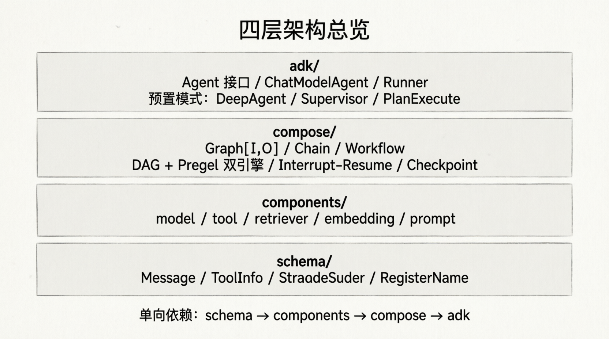

+++
date = '2026-03-11T17:48:21+08:00'
title = "Eino源码学习(一)--Schema"
tags = ["Agent","AI"]
categories = ["AI"]
+++

## 1. 前言

当我们在接触AI应用开发时，面对langchain、eino等框架，也许有过这样的疑问：**我直接调用OpenAI的api不就行了？为什么要使用一层框架。**

这个问题其实不是AI独有的，比如grpc的kratos、go-zero等优秀的微服务框架，他们的作用其实是差不多的。**在宏观层面上的核心理念确实是相通的。** 

Kratos、Go-zero 属于**微服务治理框架**，而 LangChain、Eino 属于**AI应用编排框架**。它们虽然处理的数据不同（一个是数据库/HTTP请求，一个是Token/向量），但诞生的原因和要解决的**工程痛点**高度一致：

我们可以通过下面这个对比表，看得更清楚：

| 对比维度           | 微服务框架 (Kratos / Go-zero)                          | AI编排框架 (LangChain / Eino)                                       |
| :----------------- | :----------------------------------------------------- | :------------------------------------------------------------------ |
| **核心痛点**       | 服务多了，不知道谁调谁、超时了怎么办、怎么熔断降级。   | 调LLM的步骤多了，Prompt怎么拼、Tool调完怎么传回、流式输出怎么管理。 |
| **核心抽象**       | **接口定义语言（IDL）** + **中间件（Middleware）**     | **链（Chain）/ 图（Graph）** + **回调（Callback）**                 |
| **解决的问题**     | 标准化服务间通信，提供限流、熔断、负载均衡、可观测性。 | 标准化人机交互流程，提供记忆管理、工具执行、RAG管道、Token监控。    |
| **换组件的便利性** | 换注册中心（如从Etcd换到Consul），业务代码基本不改。   | 换大模型（如从OpenAI换到Claude或Qwen），业务逻辑基本不改。          |
| **学习曲线的来源** | 要理解服务发现、负载均衡等分布式概念。                 | 要理解Chain、Agent、VectorStore等AI工程化概念。                     |

## 2. 技术优势

### 2.1 对比langchain\langgraph

lagnchain\langgraph是python语言或者TS进行编写的，那从语言的角度来讲，**为什么选 Go?**

| 维度 | Go                      | Python         | TypeScript             |
| ---- | ----------------------- | -------------- | ---------------------- |
| 泛型 | 1.18+（编译时类型安全） | 无真泛型       | 有，但常被绕开         |
| 并发 | goroutine（真并发）     | GIL 限制       | 事件循环（单线程本质） |
| 部署 | 单一二进制              | 需 Python 环境 | 需 Node/Bun 环境       |
| 性能 | 编译型，低延迟          | 解释型         | JIT，中等              |

其中在我看来，最大的关键就在于泛型。Go 的泛型让 Eino 能在编译时验证图的类型安全。

- Graph[I,O]不是运行时概念，是编译时的
- Runnable[I,O]接口在编译器就检查类型匹配
- 错误在编译器暴露，不是在生产环境运行时

对比langchain：Python的类型检查依赖运行时验证，生产环境充满隐患。

主要原因还是两个：
- **高性能优势**：作为原生 Go 实现的框架，能利用协程并发优势，可以提高效率。
- **类型检查**： 可以利用 Go 的泛型机制，在上下文传递的时候更准确，更便于大型项目的开发。


### 2.2 代码架构



- schema 层： 底层数据定义
  - Message：消息类型xitong
  - ToolInfo：工具定义
  - StreamReader[T]：流式数据提取
  - ...
- components层：基础组件接口
  - model：大模型接口
  - tool：工具接口
  - retriever：检索接口
  - enbedding：向量接口
  - prompt：提示词接口
  - ...
- compose层：编排引擎
  - Graph[I,O]：有向无环图
  - Chain\workflow：预制编排模式
  - Interrupt-Resume：中断恢复
  - Checkpoint：状态序列化
- adk层：Agent开发套件
  - ChatModelAgent：基于React的Agent
  - Runner：Agent运行器
  - DeepAgent/Supervisor/PlanExecute

## 3. 源码分析

首先，我们来看官方的原文描述。

> 我们认为，存在一个常见的组件列表，共同构成了大模型应用的常见组成部分。每类组件作为一个 interface，有完善、稳定的定义：具体的输入输出类型，明确的运行时 option，以及明确的流处理范式。

在明确的组件定义基础之上，我认为，大模型应用开发存在通用的**基座性质//的能力：

- 处理模型输出的流式编程能力；
- 支持横切面功能以及透出组件内部状态的 Callback 能力；
- 组件具体实现超出组件 interface 定义范围的 option 扩展能力。

在组件定义和通用基座能力的基础上，大模型应用开发存在相对固定的编排范式：
- 以 ChatModel（大模型）为核心，通过 ChatTemplate 注入用户输入和系统 prompt，通过 Retriever、Document Loader & Transformer 等注入上下文，经过 ChatModel 生成，输出 Tool Call 并执行，或输出最终结果。
 
### 3.1 schema底层数据定义

重点说四个东西：Message、ToolInfo/ParamsOneof、StreamReader、RegisterName

先理解这四个东西，就理解了Eino整个类型系统的设计意图。

#### 3.1.1 Message

**Message**是整个框架最核心的数据结构，承载了一次对话中的所有内容.


先来看RoleType有哪四种角色：

```go
type RoleType string

const (
	// Assistant is the role of an assistant, means the message is returned by ChatModel.
	Assistant RoleType = "assistant"
	// User is the role of a user, means the message is a user message.
	User RoleType = "user"
	// System is the role of a system, means the message is a system message.
	System RoleType = "system"
	// Tool is the role of a tool, means the message is a tool call output.
	Tool RoleType = "tool"
)
```

下面是Message的完整数据结构：

```go
type Message struct {
	Role RoleType `json:"role"`

	// Content 用于用户文本输入和模型文本输出。
	Content string `json:"content"`

	// 如果 MultiContent 不为空，则使用此字段而非 Content；
	// 如果 MultiContent 为空，则使用 Content。
	// 已弃用：请使用 UserInputMultiContent 传递用户多模态输入，
	// 使用 AssistantGenMultiContent 接收模型多模态输出。
	MultiContent []ChatMessagePart `json:"multi_content,omitempty"`

	// UserInputMultiContent 将用户提供的多模态内容传递给模型。
	UserInputMultiContent []MessageInputPart `json:"user_input_multi_content,omitempty"`

	// AssistantGenMultiContent 用于接收模型的多模态输出。
	AssistantGenMultiContent []MessageOutputPart `json:"assistant_output_multi_content,omitempty"`

	Name string `json:"name,omitempty"`

	// 仅用于 AssistantMessage（助手消息）
	ToolCalls []ToolCall `json:"tool_calls,omitempty"`

	// 仅用于 ToolMessage（工具消息）
	ToolCallID string `json:"tool_call_id,omitempty"`
	// 仅用于 ToolMessage（工具消息）
	ToolName string `json:"tool_name,omitempty"`

    // 模型响应元数据
	ResponseMeta *ResponseMeta `json:"response_meta,omitempty"`

	// ReasoningContent 是模型的思考过程，当模型返回推理内容时会包含此字段。
	ReasoningContent string `json:"reasoning_content,omitempty"`

	// 用于模型实现的自定义扩展信息
	Extra map[string]any `json:"extra,omitempty"`
}
```

关于ToolCall表示消息中的函数调用。

```go
// FunctionCall 表示消息中的函数调用。
// 它用于 Assistant Message（助手消息）中。
type FunctionCall struct {
	// Name 是要调用的函数名称，可用于标识具体的函数。
	Name string `json:"name,omitempty"`
	// Arguments 是调用函数时使用的参数，采用 JSON 格式。
	Arguments string `json:"arguments,omitempty"`
}

// ToolCall 表示消息中的工具调用。
// 当助手消息中包含需要执行的工具调用时使用此结构体。
type ToolCall struct {
	// Index 用于消息中存在多个工具调用的情况。
	// 在流式模式下，用于标识工具调用的分块以便合并。
	Index *int `json:"index,omitempty"`
	// ID 是工具调用的唯一标识符，可用于识别具体的工具调用。
	ID string `json:"id"`
	// Type 是工具调用的类型，默认为 "function"。
	Type string `json:"type"`
	// Function 是要执行的具体函数调用详情。
	Function FunctionCall `json:"function"`
	// Extra 用于存储工具调用的额外扩展信息。
	Extra map[string]any `json:"extra,omitempty"`
}
```

Eino框架提供了便携的构造函数，分别用于构造不同RoleType的Message.

```go
// SystemMessage represents a message with Role "system".
func SystemMessage(content string) *Message {
	return &Message{
		Role:    System,
		Content: content,
	}
}

// AssistantMessage represents a message with Role "assistant".
func AssistantMessage(content string, toolCalls []ToolCall) *Message {
	return &Message{
		Role:      Assistant,
		Content:   content,
		ToolCalls: toolCalls,
	}
}

// UserMessage represents a message with Role "user".
func UserMessage(content string) *Message {
	return &Message{
		Role:    User,
		Content: content,
	}
}

// ToolMessage represents a message with Role "tool".
func ToolMessage(content string, toolCallID string, opts ...ToolMessageOption) *Message {
	o := &toolMessageOptions{}
	for _, opt := range opts {
		opt(o)
	}
	return &Message{
		Role:       Tool,
		Content:    content,
		ToolCallID: toolCallID,
		ToolName:   o.toolName,
	}
}
```

ToolMessage支持通过Options设置工具名称。

```go
type toolMessageOptions struct {
	toolName string
}

// ToolMessageOption defines a option for ToolMessage
type ToolMessageOption func(*toolMessageOptions)

// WithToolName returns a ToolMessageOption that sets the tool call name.
func WithToolName(name string) ToolMessageOption {
	return func(o *toolMessageOptions) {
		o.toolName = name
	}
}
```

还有一个重要的内部函数叫**ConcatMessages**,用来做流式合并。

流式ChatModel是一个token一个token输出，每个chunk都是一个不完整的Message，这个函数把chunk序列合并成完整message，主要应用是在compose层用来做流式同步的自动转换。

```go
// ConcatMessages 核心作用：
// 将大模型流式响应（SSE）产生的多个增量 Message 数据块（Chunks），
// 拼接合并成一个完整、连贯的最终 Message 对象。
func ConcatMessages(msgs []*Message) (*Message, error) {
	
	// ==========================================
	// 阶段 1：初始化与内存预分配
	// ==========================================
	var (
		contents            []string
		contentLen          int // 记录文本总长度，用于后续字符串高效拼接
		reasoningContents   []string
		reasoningContentLen int // 记录推理模型（如 o1/R1）思考过程的总长度
		
		toolCalls                     []ToolCall
		multiContentParts             []ChatMessagePart
		assistantGenMultiContentParts []MessageOutputPart
		userInputMultiContentParts    []MessageInputPart
		
		ret       = Message{} // 最终要返回的完整 Message 对象
		extraList = make([]map[string]any, 0, len(msgs))
	)

	// ==========================================
	// 阶段 2：遍历流式数据块，进行校验与数据收集
	// ==========================================
	for idx, msg := range msgs {
		// 2.1 基础防御：防止流中出现空数据块导致 Panic
		if msg == nil {
			return nil, fmt.Errorf("unexpected nil chunk in message stream, index: %d", idx)
		}

		// 2.2 元数据一致性校验：
		// Role、Name、ToolCallID 等基础属性在同一个流式会话中必须保持一致。
		// 逻辑：首次遇到则赋值，后续遇到若发生冲突则直接报错，防止数据错乱。
		if msg.Role != "" {
			if ret.Role == "" {
				ret.Role = msg.Role 
			} else if ret.Role != msg.Role {
				return nil, fmt.Errorf("cannot concat messages with different roles...") 
			}
		}
		// ... [省略] Name, ToolCallID, ToolName 的类似一致性校验逻辑 ...


		// 2.3 收集文本与推理内容，并累加长度
		if msg.Content != "" {
			contents = append(contents, msg.Content)
			contentLen += len(msg.Content) // 累加长度，为阶段3的内存预分配做准备
		}
		if msg.ReasoningContent != "" { 
			// 专门适配 DeepSeek-R1 / OpenAI o1 等推理模型的“思维链/思考过程”
			reasoningContents = append(reasoningContents, msg.ReasoningContent)
			reasoningContentLen += len(msg.ReasoningContent)
		}

		// 2.4 收集其他复杂字段（工具调用、额外信息、多模态内容等）
		if len(msg.ToolCalls) > 0 { toolCalls = append(toolCalls, msg.ToolCalls...) }
		// ... [省略] Extra, MultiContent 等切片的 append 逻辑 ...


		// 2.5 核心元数据 ResponseMeta 的特殊合并策略（深刻理解流式 API 的返回特性）
		if msg.ResponseMeta != nil && ret.ResponseMeta != nil {
			
			// 策略 A: FinishReason（结束原因）
			// 潜规则：通常只在流的【最后一个 chunk】返回。因此采用“覆盖”策略，保留最后一个有效值。
			if msg.ResponseMeta.FinishReason != "" {
				ret.ResponseMeta.FinishReason = msg.ResponseMeta.FinishReason
			}

			// 策略 B: Usage（Token 消耗统计）
			// 潜规则：可能是增量返回，也可能只在最后返回。通过比较【保留最大值】，确保统计不丢失。
			if msg.ResponseMeta.Usage != nil {
				if msg.ResponseMeta.Usage.PromptTokens > ret.ResponseMeta.Usage.PromptTokens {
					ret.ResponseMeta.Usage.PromptTokens = msg.ResponseMeta.Usage.PromptTokens
				}
				// ... [省略] CompletionTokens, TotalTokens 等取最大值的比较逻辑 ...
			}

			// 策略 C: LogProbs（对数概率）
			// 潜规则：逐 Token 返回。因此采用“追加”策略，拼接成完整的概率分布。
			if msg.ResponseMeta.LogProbs != nil {
				ret.ResponseMeta.LogProbs.Content = append(ret.ResponseMeta.LogProbs.Content, msg.ResponseMeta.LogProbs.Content...)
			}
		}
	}

	// ==========================================
	// 阶段 3：高效拼装与复杂对象合并
	// ==========================================
	
	// 3.1 极致优化的字符串拼接：
	// 利用阶段2计算的总长度，调用 Grow() 一次性申请足够的底层内存。
	// 避免了 Go 语言中直接使用 "+" 拼接字符串导致的频繁内存重新分配和拷贝。
	if len(contents) > 0 {
		var sb strings.Builder
		sb.Grow(contentLen) // 核心性能优化点
		for _, content := range contents {
			sb.WriteString(content)
		}
		ret.Content = sb.String()
	}
	// ... [省略] reasoningContents 的类似高效拼接逻辑 ...


	// 3.2 委托辅助函数合并复杂结构：
	// 流式返回的 ToolCall 参数（如 JSON 字符串）通常是分片返回的，
	// 需要专门的逻辑根据 Index 或 ID 将 JSON 片段重组为完整的参数。
	if len(toolCalls) > 0 {
		merged, err := concatToolCalls(toolCalls)
		if err != nil { return nil, err }
		ret.ToolCalls = merged
	}
	
	// ... [省略] Extra, AssistantGenMultiContent, UserInputMultiContent 的辅助函数合并逻辑 ...


	// 3.3 直接赋值已废弃但为向后兼容保留的字段
	if len(multiContentParts) > 0 {
		ret.MultiContent = multiContentParts
	}

	return &ret, nil
}
```

#### 3.1.2 ToolInfo

ToolInfo 是工具的信息。描述了一个可以通过**[ToolCallingChatModel.WithTools]** 或 **[ChatModel.BindTools]** 传递给 ChatModel 的工具。

```go
// Name 应该在工具集中简洁且唯一。
// Desc 应该解释何时以及为何使用该工具；Desc 中的少样本示例可以显著提高模型的准确性。
// 对于不需要任何输入参数的工具，ParamsOneOf 可以为 nil。
type ToolInfo struct {
	// 工具的唯一名称，应清晰传达其用途。
	Name string
	// 用于告诉模型如何/何时/为何使用该工具。
	// 你可以提供少样本示例作为描述的一部分。
	Desc string
	// Extra 是工具的额外信息。
	Extra map[string]any

	// 函数接受的参数（不同模型可能需要不同的参数类型）。
	// 可以通过两种方式描述：
	//  - 使用 params: schema.NewParamsOneOfByParams(params)
	//  - 使用 jsonschema: schema.NewParamsOneOfByJSONSchema(jsonschema)
	// 如果为 nil，表示该工具不需要任何输入参数
	*ParamsOneOf
}

type ParamsOneOf struct {
	// use NewParamsOneOfByParams to set this field
	params map[string]*ParameterInfo

	jsonschema *jsonschema.Schema
}
```


参数说明有两种描述方式。

方式一：ParameterInfo

这是一种轻量级的表达方式。使用map数组来对参数进行描述。覆盖常见场景：标量、数组、嵌套对象、枚举.

eino会把它转为JSON Schema再传给模型。

```go
type ParameterInfo struct {
	// 参数的数据类型。
	Type DataType
	// 参数的元素类型，仅当参数类型为数组（array）时有效。
	ElemInfo *ParameterInfo
	// 参数的子参数，仅当参数类型为对象（object）时有效。
	SubParams map[string]*ParameterInfo
	// 参数的描述信息。
	Desc string
	// 参数的枚举值，仅当参数类型为字符串（string）时有效。
	Enum []string
	// 标识该参数是否为必填项。
	Required bool
}

// NewParamsOneOfByParams 使用 map[string]*ParameterInfo 创建一个 ParamsOneOf。
func NewParamsOneOfByParams(params map[string]*ParameterInfo) *ParamsOneOf {
	return &ParamsOneOf{
		params: params,
	}
}
```

使用方式：

```go
params := schema.NewParamsOneOfByParams(map[string]*schema.ParameterInfo{
    "query":{
        Type:schema.String,
        Desc:"搜索关键词",
        Required:true,
    },
    "arr":{
        Type:     schema.Array, // 声明该参数本身是一个数组
        Desc:     "文章的标签列表",
        Required: true,
    
        // ElemInfo 用于描述数组中“每一个元素”的数据类型和结构
        ElemInfo: &schema.ParameterInfo{
            Type: schema.String, // 表示数组里的每个元素都是字符串类型
            Desc: "具体的标签名称",
        },
    },
    "obj":{
        Type:     schema.Object, // 声明该参数本身是一个对象 (JSON Object)
        Desc:     "用户的基本信息",
        Required: true,
        
        // SubParams 用于描述对象内部包含的“各个子属性（Key-Value）”
        SubParams: map[string]*schema.ParameterInfo{
            "name": {
                Type:     schema.String,
                Desc:     "用户姓名",
                Required: true,
            },
            "age": {
                Type:     schema.Integer,
                Desc:     "用户年龄",
                Required: false, // 年龄是非必填的
            },
        },
    }

})
```


方式二：JSON Schema

直接传入Json schema格式。

```go
// NewParamsOneOfByJSONSchema creates a ParamsOneOf with *jsonschema.Schema.
func NewParamsOneOfByJSONSchema(s *jsonschema.Schema) *ParamsOneOf {
	return &ParamsOneOf{
		jsonschema: s,
	}
}
```

#### 3.1.3 StreamReader[T]

eino的流式处理基于泛型StreamReader，有两个核心方法：

- Recv：读取下一个chunk，EOF表示结束
- Close：必须关闭，否则goroutine泄露
  
```go
// StreamReader 是 Eino 流（Stream）的消费者端。
//
// StreamReader 具有“一次性读取”特性：
// 1. 仅允许一个 goroutine 调用 Recv 方法。
// 2. 无论循环正常结束还是通过 break/return 提前退出，都必须恰好关闭（Close）一次 reader。
//
// 典型用法：
//
//	defer sr.Close() // 务必关闭，即使遇到 io.EOF 也要关闭
//	for {
//	    chunk, err := sr.Recv()
//	    if errors.Is(err, io.EOF) {
//	        break
//	    }
//	    if err != nil {
//	        return err
//	    }
//	    process(chunk)
//	}
//
// 若要将单个流扇出（fan-out）给 N 个独立的消费者，请在调用任何 Recv 之前调用 [StreamReader.Copy]；
// 调用 Copy 后，原始的 reader 将变为不可用状态。
//
// StreamReader 由以下函数创建：[Pipe], [StreamReaderFromArray],
// [MergeStreamReaders], [MergeNamedStreamReaders], 以及 [StreamReaderWithConvert]。
type StreamReader[T any] struct {
	typ readerType

	st *stream[T]

	ar *arrayReader[T]

	msr *multiStreamReader[T]

	srw *streamReaderWithConvert[T]

	csr *childStreamReader[T]
}

// Recv 从流中接收一个值。
// 示例：
//
//	for {
//		chunk, err := sr.Recv()
//		if errors.Is(err, io.EOF) {
//			break
//		}
//		if err != nil {
//			panic(err)
//		}
//		fmt.Println(chunk)
//	}
func (sr *StreamReader[T]) Recv() (T, error) {
	switch sr.typ {
	case readerTypeStream:
		return sr.st.recv()
	case readerTypeArray:
		return sr.ar.recv()
	case readerTypeMultiStream:
		return sr.msr.recv()
	case readerTypeWithConvert:
		return sr.srw.recv()
	case readerTypeChild:
		return sr.csr.recv()
	default:
		panic("impossible")
	}
}

func (sr *StreamReader[T]) Close() {
	switch sr.typ {
	case readerTypeStream:
		sr.st.closeRecv()
	case readerTypeArray:

	case readerTypeMultiStream:
		sr.msr.close()
	case readerTypeWithConvert:
		sr.srw.close()
	case readerTypeChild:
		sr.csr.close()
	default:
		panic("impossible")
	}
}
```

StreamReader有以下重要操作：

| 操作                              | 说明                                      |
| :-------------------------------- | :---------------------------------------- |
| **StreamReaderWithConvert[T, U]** | 在读取时动态转换类型，无需缓存整个流      |
| **StreamReaderFromArray**         | 从切片构造流，常用于测试                  |
| **ConcatMessageStream**           | 把流式 Message 序列合并成一个完整 Message |

ErrorValue是当前chunk不输出内容的哨兵值。


#### 3.1.4 RegisterName[T]

这个函数是Eino的checkpoint检查点机制的基础。

Eino的checkpoint用`encoding/gob`序列化，`gob`遇到`any`或`interface{}`类型的字段时，需要预先知道里面可能存什么具体类型，不注册运行时就会panic，而且panic信息不友好。

RegisterName规则：

- **必须注册的场景**：任何想存入`state.extra`或`session`的自定义类型
- **已注册的内置类型**：*State*、*checkpoint*、*dagChannel*等已在各自的init()中注册
- **命令约定**：eino内置以`_eino_`开头，用户用`包名_类型名`格式，确保全局唯一。

比如：
```go
func init(){
    schema.RegisterName[*MyCustomState]("my_package_my_custom_state")
}
```

### 3.2 小结

schema层的核心是三件事：
- Message的四角色模型：User、Assistant、System、Tool
- ToolInfo的两种参数描述：ParameterInfo轻量方式  vs  JSON Schema完整方式
- RegisterName的gob注册机制：checkpoint功能的入场券


