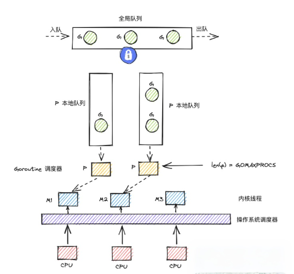
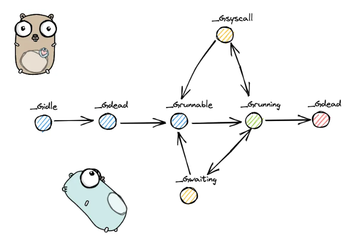
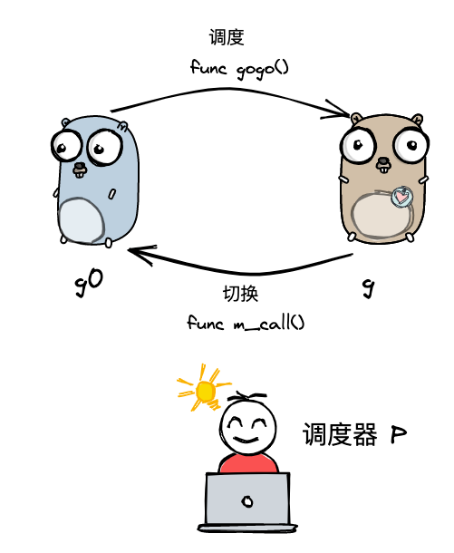
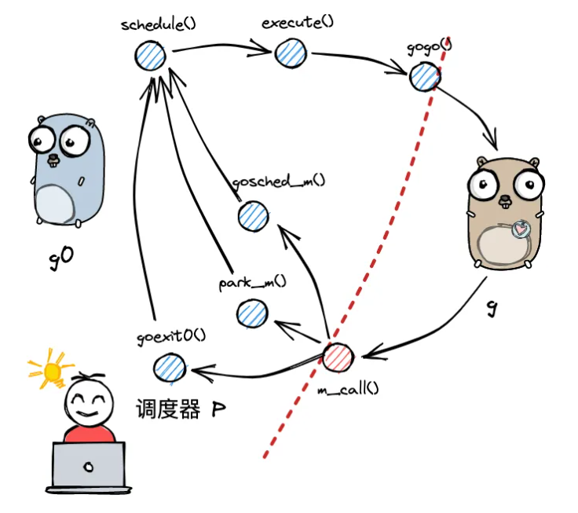
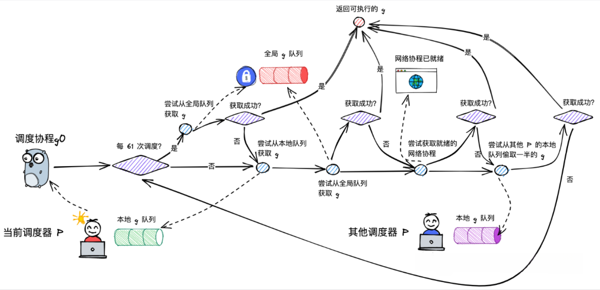
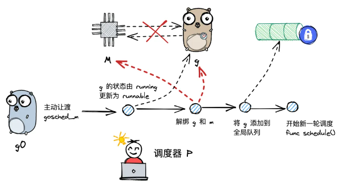

+++
date = '2025-8-19T20:36:12+08:00'
title = "GMP原理"
tags = ["go"]
categories = ["go"]
+++

写 Go 并发程序时，我们经常随手就是一句 go func() {}，但有没有想过：一个 goroutine 为什么能做到这么轻量？成千上万个 goroutine 又是如何被映射到有限的 CPU 核心上执行的？这背后就是 Go 运行时调度器的核心设计——GMP 模型。本文不打算一上来堆术语，而是从“一个 goroutine 从创建到被执行”的链路出发，把 G、M、P 分别是什么、为什么需要它们，以及它们如何协作讲清楚。

## 1. 概念

在开始下面的讲解之前，我们先需要知道一些概念

### 1.1 线程

线程是 **CPU 调度和执行的最小单位**。它不能独立存在，必须隶属于某个进程；一个进程里可以有多个线程，每个线程代表一条独立的执行流。

同一进程内的线程共享进程的大部分资源，但每条线程必须拥有自己的一份“执行现场”：

- 栈（函数调用链、局部变量）
- 程序计数器 PC、寄存器、栈指针 SP
- 线程本地存储、优先级等调度状态

我们平时说的“线程”默认指**内核级线程（KLT）**：由操作系统内核创建和调度，内核看不见用户代码里的“任务”，只看见一个个线程。因此线程的创建、销毁、阻塞与切换都要通过系统调用陷入内核态，需要保存/恢复寄存器上下文，代价在 μs 级；Linux 下 pthread 的默认栈通常是 8MB，开几万个线程光地址空间就吃不消。

**关键点**：线程阻塞在同步 IO 等系统调用上时，内核只是把它挂起，其他线程仍可被调度。

### 1.2 进程

进程是 **资源分配的基本单位**，是“程序的一次执行实例”。内核用 PCB（进程控制块）描述它，并为它分配一整套独立的资源：

- 独立的虚拟地址空间与页表
- 代码段、数据段、堆、栈
- 文件描述符表、PID、信号处理、环境变量

“独立”意味着进程之间默认**不共享内存**：A 进程写坏自己的内存不会直接破坏 B 进程，代价是通信必须走 IPC（管道、消息队列、共享内存、socket 等）。也正因为要切换页表、通常还会带来 TLB 与 Cache 失效，进程上下文切换比线程切换更重。

进程和线程的关系可以一句话概括：**进程是资源的容器，线程是容器里真正跑起来的执行流**。打个比方，进程像一间配好水电和工具的车间，线程是车间里的工人；工人共享车间的场地与工具，但各有自己的工位（栈）和手上正在做的活（PC、寄存器）。新开一间车间很贵，多雇一个工人便宜得多。

| 对比 | 进程 | 线程 |
| :--- | :--- | :--- |
| 定位 | 资源分配单位 | CPU 调度单位 |
| 地址空间 | 各自独立 | 共享所属进程 |
| 独有 | 页表、fd 表、PID | 栈、PC、寄存器、TLS |
| 通信 | IPC | 直接读写共享内存（需同步） |
| 切换代价 | 高（换页表、TLB 失效） | 中（不换页表，但仍陷入内核） |

### 1.3 协程

协程是**用户态的“轻量线程”**：它的创建、切换、销毁全部由用户态完成，内核完全不知情。

切换协程不需要陷入内核，只要把信息保存到自己的上下文里，再把另一个协程的上下文装回来即可，成本在百纳秒量级；栈也能做成按需增长的几 KB，而不是一上来就预留 8MB。代表实现有Python 的 generator / asyncio、Kotlin 协程，以及 Go 的 goroutine。

按调度方式可分为两类：

- **协作式**：协程主动 `yield` 才让出执行权。实现简单，但一个协程死循环或迟迟不让出，其他协程就得饿死。
- **抢占式**：运行时在安全点或借助信号强制夺回执行权，公平性更好，实现复杂度也高得多。

协程的两处硬伤：

1. **不能天然利用多核**：内核只看到一个线程，多个协程只能在这一个线程上轮流跑，谈不上并行。
2. **阻塞会传染**：某个协程发起阻塞系统调用，承载它的内核线程被挂起，绑在这条线程上的所有协程一起卡住。

要解开这个死结，只能由运行时接管调度，把“协程”和“内核线程”解绑。

### 1.4 goroutine

goroutine 是 **Go 对协程的实现**。

```go
go func() {
    fmt.Println("hello")
}()
```

但它并不等同于传统协程，差别在于 Go 运行时（runtime）替它兜了底：

- **极轻**：初始栈只有 2KB 左右，按需扩缩（扩容时分配新栈并拷贝，指针由运行时调整），因此轻松创建几十万个也不稀奇；创建和切换都在用户态完成。
- **不绑死内核线程**：goroutine 由 Go 自己的调度器分配到操作系统线程上执行，是典型的 M:N 映射，既轻量又能真正跑满多核。
- **阻塞不拖累别人**：网络 IO 交给 netpoller 转成非阻塞 + 事件等待；遇到不可避免的阻塞系统调用，运行时会把当前 P 转交给另一个线程继续调度其它 goroutine（`handoff`），不会让整个程序停摆。Go 1.14 起还引入了基于信号的异步抢占，避免一个死循环 goroutine 长期霸占 CPU。

还有两点使用时值得记住：goroutine 没有对外暴露的 ID，也不能从外部“强杀”，退出要靠 `channel`、`context` 协作通知；另外它保证的是**并发**，是否**并行**取决于 `GOMAXPROCS`（默认约为可用 CPU 核数）。

### 1.5 小结

把四者放到一起看：

| 维度 | 进程 | 线程 | 协程 | goroutine |
| :--- | :--- | :--- | :--- | :--- |
| 谁调度 | 内核 | 内核 | 用户态库 | Go runtime |
| 切换是否陷内核 | 是 | 是 | 否 | 否 |
| 栈 | 独立地址空间 + 栈 | 默认 8MB | 几 KB | 初始约 2KB，可扩缩 |
| 多核并行 | 能 | 能 | 通常不能 | 能（M:N） |
| 阻塞影响 | 只影响自己 | 只影响自己 | 可能拖垮同线程所有协程 | 运行时接管，不拖累其它 G |

从进程到 goroutine，本质上是一条“把调度权逐步从内核搬到用户态、把执行单元越做越轻”的路。而调度权一旦搬到用户态，就必须有人来决定“哪个任务在哪条线程上跑” —— 这就是下一节要讲的 Go 调度器。


## 2. GMP 模型

### 2.1 远古GM模型

只有两个角色：

- G：goroutine，是 golang 中对协程的抽象
- M：machine，是 golang 中对线程的抽象

所有等待运行的 G，都被统一放在一个全局队列里。任何一个空闲的 M，都会直接尝试从这个全局队列中获取一个 G 来执行。

**为什么它被淘汰了？**

这个模型在并发量不高时看起来没问题，但它存在致命的性能瓶颈，核心问题几乎都源于**全局队列**。

- 最严重的问题：**全局锁竞争**：
为了保证多个 M 同时从一个全局队列中安全地获取 G，这个队列必须被一把全局互斥锁保护。这意味着，每一次 G 的创建、完成、重新入队，以及 M 获取下一个 G，都必须先争抢这把锁。当并发量很高时，大量的 M 会阻塞在锁的争抢上，而非执行实际的业务代码，这严重限制了 Go 程序的可扩展性。

- 其余的问题：
  - 局部性差：G 在被一个 M 执行完后，会被放回全局队列。它下一次被哪个 M 捞出来执行是完全随机的，这破坏了缓存的局部性，导致性能下降。
  - 阻塞处理笨拙：当一个 G 执行阻塞式系统调用（比如读文件）时，它所在的 M 也会被操作系统内核挂起。在 GM 模型下，这可能导致处理能力的浪费，因为调度逻辑与这个被阻塞的 M 绑定得比较死。

### 2.2 GMP

正是因为 GM 模型的这些痛点，Go 团队在 1.1 版本引入了 P (Processor)，将模型升级为今天的 GMP。P 的核心作用就是充当 M 和 G 之间的“中间层” 和 “本地缓存”.

核心思想只有一句话：
**把"执行 Go 代码所需的资源和上下文"从 M 身上剥离出来，放到 P 上。**
**M 只是"执行体"，必须先绑定一个 P 才能跑 Go 代码；M 阻塞了，P 可以立刻被别的 M 抢走继续干活。**

- **本地队列**：每个 P 都维护一个自己的本地 G 队列。M 在执行时，会绑定到一个 P，并优先从自己的 P 的本地队列中获取 G。访问本地队列不需要全局锁，彻底消除了获取 G 时的主要锁竞争。
- **Work Stealing (工作窃取)**：当一个 P 的本地队列为空时，它不会闲着，而是会尝试去“偷”其他 P 本地队列里一半的 G 过来执行。只有在所有其他 P 的队列也为空时，才会去访问被弱化的全局队列。这实现了负载均衡，并大大减少了全局锁的使用频率。

组件关系图：



## 3. 核心数据结构

### 3.1 G

```go
// runtime/runtime2.go
type g struct {
    stack       stack   // goroutine 栈就在这
    stackguard0 uintptr 
    stackguard1 uintptr 

    m            *m       // 当前占有它的 M
    sched        gobuf    // 调度现场：goroutine 让出 CPU 时，把现场存这儿；恢复时从这儿读。
    atomicstatus atomic.Uint32 // G 的状态（_Grunnable/_Grunning/...）
    goid         uint64   // goroutine id（panic 里看到的那个）

    schedlink    guintptr // 串成运行队列链表的指针
    param        unsafe.Pointer // 被唤醒时的传参（如 netpoll 的字节数）
    waitsince    int64    // 进入阻塞的时间，用于 trace 统计
    waitreason   waitReason // 阻塞原因：chan receive / select / sleep ...

    preempt      bool // 抢占标志
    preemptStop  bool // true 则切到 _Gpreempted 而非直接重新入队

    lockedm      muintptr // LockOSThread 绑定的 M
    waiting      *sudog   // 正挂在哪个 channel/mutex 的等待队列上
    timer        *timer   // time.Sleep 用的定时器
    startpc      uintptr  // go 语句启动的那个函数 PC（trace 里显示的名字）
    gcAssistBytes int64   // GC 辅助标记的"欠债"
}


type gobuf struct {
    sp   uintptr // 保存 CPU 的 rsp 寄存器的值，指向函数调用栈栈顶
    pc   uintptr // 保存 CPU 的 rip 寄存器的值，指向程序下一条执行指令的地址
    ret  uintptr // 保存系统调用的返回值；
    bp   uintptr // 保存 CPU 的 rbp 寄存器的值，存储函数栈帧的起始位置.
}
```

其中g的生命周期由以下几个状态：



```go
const(
  _Gidle = itoa // 0 协程开始创建时的状态，此时尚未初始化完成；
  _Grunnable // 1 协程在待执行队列中，等待被执行；
  _Grunning // 2 协程正在执行，同一时刻一个 p 中只有一个 g 处于此状态
  _Gsyscall // 3 协程正在执行系统调用
  _Gwaiting // 4 协程处于挂起态，需要等待被唤醒. gc、channel 通信或者锁操作时经常会进入这种状态；
  _Gdead // 6 协程刚初始化完成或者已经被销毁，会处于此状态；
  _Gcopystack // 8 协程正在栈扩容流程中;
  _Gpreempted // 9 协程被抢占后的状态;
)
```

### 3.2 M

```go
type m struct {
    g0      *g     // 调度专用 goroutine，每个 M 都有一个，栈是 OS 分配的（8MB/系统栈）
    gsignal *g     // 处理信号的专用 g（异步抢占就靠它）

    curg    *g       // 当前正在跑的用户 goroutine
    p       puintptr // 当前持有的 P
    nextp   puintptr // 被唤醒时预先分配好的 P
    oldp    puintptr // 陷入 syscall 之前持有的 P（exitsyscall 想抢回来）

    id      int64
    spinning bool    // 是否处于"自旋找工作"状态
    blocked  bool    // 是否阻塞在 notesleep
    park     note    // 用于 park/unpark 这个线程的信号量（futex）
    alllink  *m      // 所有 M 的链表（allm）
    schedlink muintptr // 空闲 M 链表

    lockedg  guintptr // 与某个 G 互相绑定（LockOSThread）
    mstartfn func()   // 线程启动函数（如 sysmon）
    tls      [tlsSlots]uintptr // 线程本地存储，g 指针就存在这
}
```

其中的g0是一类特殊的调度协程，不用于执行用户函数，负责执行 g 之间的切换调度. 与 m 的关系为 1:1；


### 3.3 P

```go
type p struct {
    // ...
    runqhead uint32 // 队列头部
    runqtail uint32 // 队列尾部
    runq     [256]guintptr // 本地 goroutine 队列，最大长度为 256
    
    runnext guintptr // 下一个可执行的 goroutine
    // ...
}
```

runnext 是最容易被忽略、但性能收益最大的设计。 想象生产者-消费者：P0 上的消费者 G1 从 channel 收到数据后，唤醒了阻塞的生产者 G2.
如果 G2 被丢到队尾，它要等本地 256 个 G 都跑完；有了 runnext，G2 下一个就跑.它刚刚写的变量还在 L1 cache 里，通信双方的数据热度完美衔接。这是 channel 通信在 Go 里如此廉价的关键原因之一。

### 3.4 schedt 全局调度器

```go
type schedt struct {
    // ...
    lock mutex // 一把操作全局队列时使用的锁
    // ...
    runq     gQueue // 全局 goroutine 队列
    runqsize int32 // 全局 goroutine 队列的容量
    // ...
}
```

## 4. 调度流程

### 4.1 两种g的转换



g0 是每个 M（操作系统线程）内部自带的一个特殊的、专用于调度的 Goroutine。它不执行你的业务代码，它的唯一使命是为 Go 运行时（runtime）的调度器、系统调用和垃圾回收等核心逻辑提供一个安全、稳定的执行环境

g0 上跑的是 Go 运行时自己的代码，比如：

- 选择下一个要运行的 G；

- 保存/恢复 G 的上下文；

- 处理系统调用前后的调度；

- 栈增长、GC 相关的一些辅助工作。

这些代码仍然是 Go runtime 在用户态执行的代码.

当一个 G 需要执行调度相关操作时（比如主动让出 CPU、发起系统调用），它会从自己的用户栈切换到所属 M 的 g0 栈上。这个切换动作在 runtime 中由特定的函数完成，例如 `mcall` 和 `systemstack`。

m 通过 p 调度执行的 goroutine 永远在普通 g 和 g0 之间进行切换，当 g0 找到可执行的 g 时，会调用 gogo 方法，调度 g 执行用户定义的任务；当 g 需要主动让渡或被动调度时，会触发 `mcall` 方法，将执行权重新交还给 g0.

### 4.2 调度流程



对 gmp 的宏观调度流程进行整体串联：

（1）以 g0 -> g -> g0 的一轮循环为例进行串联；

（2）g0 执行 schedule() 函数，寻找到用于执行的 g；

（3）g0 执行 execute() 方法，更新当前 g、p 的状态信息，并调用 gogo() 方法，将执行权交给 g；

（4）g 因主动让渡( gosche_m() )、被动调度( park_m() )、正常结束( goexit0() )等原因，调用 m_call 函数，执行权重新回到 g0 手中；

（5）g0 执行 schedule() 函数，开启新一轮循环.

#### 4.2.1 schedule

调度流程的主干方法是位于 runtime/proc.go 中的 `schedule` 函数，此时的执行权位于 g0 手中：

```go
func schedule() {
    // ...
    gp, inheritTime, tryWakeP := findRunnable() // blocks until work is available


    // ...
    execute(gp, inheritTime)
}
```

（1）寻找到下一个执行的 goroutine；

（2）执行该 goroutine.

调度流程中，一个非常核心的步骤，就是为 m 寻找到下一个执行的 g，这部分内容位于 runtime/proc.go 的 `findRunnable` 方法中：



findRunnable 的查找过程是分层的，优先选择开销最小、局部性最好的路径：

1. **检查本地队列 (runqget)**
这是最快、无锁的路径。它会优先检查当前 P 的 runnext 插槽，然后是其普通本地队列。这是为了最大化缓存局部性，刚刚被创建或唤醒的 G 能最快被执行。

2. **周期性检查全局队列 (防饥饿)**
为了防止全局队列中的 G 被“饿死”，findRunnable 做了一个特殊设计：每进行 61 次调度，就会强制检查一次全局队列（globrunqget），并从中获取 G。这是一个概率上的公平性保证。

3. **常规检查全局队列**
如果 sched.runqsize > 0，说明全局队列里有待运行的 G。此时会获取 sched.lock 锁，然后调用 globrunqget 取一个 G 出来。这是一个带锁的操作，开销比本地队列大。

4. **轮询网络 (netpoll)**
如果前几步都没找到 G，调度器会检查网络轮询器（netpoller）是否有就绪的 I/O 事件。如果有，它会返回对应的 G。这是一个“优化”步骤，在尝试昂贵的窃取操作之前，先处理掉可能已经就绪的 I/O 任务。

5. **工作窃取 (runqsteal)**
当以上所有“常规”手段都失败后，才会启动最复杂的工作窃取机制：

- 尝试次数：最多尝试 4 轮。

- 随机目标：每一轮都会以随机的顺序尝试从其他 P 的本地队列中窃取。

- 窃取策略：在最初几轮，它会优先窃取那些队列中 G 的数量大于 1 的 P，以避免打扰那些只有一个 G 的 P。只有在后续轮次中，才会考虑去“偷”对方 runnext 里的 G。

- 偷取数量：runqsteal 只会窃取目标 P 本地队列中一半的 G，以平衡负载，防止把对方的任务“偷光”。

6. **关键的调度保护机制**
在进入昂贵的工作窃取之前，`findRunnable` 会进行一些判断，避免无意义的资源消耗：

- **防止“无效窃取”：**如果除了当前 M 之外，所有其他 P 都处于空闲状态（npidle == procs-1），那么去窃取是毫无意义的，因为别处肯定也没有任务。此时会直接跳到睡眠步骤。

- **防止“过度自旋”：**如果系统中已经有足够多的 M 处于“自旋”（spinning，即正在积极寻找任务的状态），那么当前 M 就没必要再加入。判断条件是 2 * nmspinning >= procs - npidle。如果条件满足，当前 M 也会直接去睡眠，避免大量空闲 M 同时空转消耗 CPU。

7. **睡眠**
如果经过以上所有努力仍然找不到 G，findRunnable 不会让 M 直接“死掉”，而是会：

- 执行 GC 标记工作：如果 GC 正在标记阶段且有可用的后台标记 Worker，M 会去执行这些 GC 工作。

- 进入“停车”状态：如果确实无事可做，M 会调用 stopm()，将 P 归还，并让 M 进入睡眠，等待被新任务唤醒。

#### 4.2.2 execute

当 g0 为 m 寻找到可执行的 g 之后，接下来就开始执行 g. 这部分内容位于 runtime/proc.go 的 execute 方法中：

```go
func execute(gp *g, inheritTime bool) {
    _g_ := getg()


    _g_.m.curg = gp
    gp.m = _g_.m
    casgstatus(gp, _Grunnable, _Grunning)
    gp.waitsince = 0
    gp.preempt = false
    gp.stackguard0 = gp.stack.lo + _StackGuard
    if !inheritTime {
        _g_.m.p.ptr().schedtick++
    }


    gogo(&gp.sched)
```

（1）更新 g 的状态信息，建立 g 与 m 之间的绑定关系；

（2）更新 p 的总调度次数；

（3）调用 gogo 方法，执行 goroutine 中的任务.

#### 4.2.3 gosched_m

g 执行主动让渡时，会调用 mcall 方法将执行权归还给 g0，并由 g0 调用 gosched_m 方法，位于 runtime/proc.go 文件中：



```go
func gosched_m(gp *g) {
    goschedImpl(gp)
}


func goschedImpl(gp *g) {
    status := readgstatus(gp)
    if status&^_Gscan != _Grunning {
        dumpgstatus(gp)
        throw("bad g status")
    }
    casgstatus(gp, _Grunning, _Grunnable)
    dropg()
    lock(&sched.lock)
    globrunqput(gp)
    unlock(&sched.lock)


    schedule()
```

（1）调用casgstatus() 方法，将当前 g 的状态由执行中切换为待执行 _Grunnable;
（2）调用 dropg() 方法，将当前的 m 和 g 解绑；
（3）调用globrunqput() 方法，将 g 添加到全局队列当中；
（4）开启新一轮的调度；

#### 4.2.4 park_m

g 需要被动调度时，会调用 mcall 方法切换至 g0，并调用 park_m 方法将 g 置为阻塞态，执行流程位于 `runtime/proc.go` 的 `gopark` 方法当中

```go
func park_m(gp *g) {
    _g_ := getg()


    casgstatus(gp, _Grunning, _Gwaiting)
    dropg()


    // ...
    schedule()
```
（1）将当前 g 的状态由 running 改为 waiting；

（2）将 g 与 m 解绑；

（3）执行新一轮的调度 schedule.

#### 4.2.5 goready

当因被动调度陷入阻塞态的 g 需要被唤醒时，会由其他协程执行 goready 方法将 g 重新置为可执行的状态，方法位于 runtime/proc.go .

被动调度如果需要唤醒，则会其他 g 负责将 g 的状态由 waiting 改为 runnable，然后会将其添加到唤醒者的 p 的本地队列中：

```go
func goready(gp *g, traceskip int) {
    systemstack(func() {
        ready(gp, traceskip, true)
    })
}

func ready(gp *g, traceskip int, next bool) {
    // ...
    _g_ := getg()
    // ...
    casgstatus(gp, _Gwaiting, _Grunnable)
    runqput(_g_.m.p.ptr(), gp, next)
    // ...
}
```

（1）先将 g 的状态从阻塞态改为可执行的状态；

（2）调用 runqput 将当前 g 添加到唤醒者 p 的本地队列中，如果队列满了，会连带 g 一起将一半的元素转移到全局队列.

#### 4.2.6 goexit0

当 g 执行完成时，会先执行 mcall 方法切换至 g0，然后调用 `goexit0` 方法，内容为 `runtime/proc.go`：

```go
func goexit0(gp *g) {
    _g_ := getg()
    _p_ := _g_.m.p.ptr()


    casgstatus(gp, _Grunning, _Gdead)
    // ...
    gp.m = nil
    // ...


    dropg()


    // ...
    schedule()
```
（1）将 g 状态置为 dead；

（2）解绑 g 和 m；

（3）开启新一轮的调度.

### 4.3 周期性系统检查

在 GMP 模型中，P 是执行 Go 代码的“许可证”。一个 M 只有拿到 P，才能运行 G。这个机制本身是高效的，但有两个场景会打破平衡：

1. **Goroutine 长时间运行**：一个 G 在拿到 P 之后，如果内部是一个死循环或者进行着非常耗时的计算，它就会一直霸占着 P 和 M，导致同一个 P 队列里的其他 G 永远得不到执行，造成饥饿。
2. **系统调用 时间太长**：当一个 G 发起阻塞式系统调用（比如读一个很慢的磁盘）时，承载它的 M 会陷入内核态并阻塞，同时它持有的 P 也会被一起“卡住”。此时，P 就无法去调度其他 G 了，哪怕系统里还有其他 G 在排队等待执行。这浪费了 P 这个宝贵的并行资源。

`retake` 的核心目的，就是主动介入并纠正这两种资源错配。

retake 的逻辑并不复杂，它由 sysmon 线程周期性地（大约每 10ms）调用，遍历所有 P，并根据 P 的当前状态来决定是否需要进行“收回”操作。

针对第一种场景，也就是P 处于 _Prunning 状态（G 正在运行），如果 sysmon 发现 schedtick 在超过 10ms (forcePreemptNS) 的时间窗口内都没有变化，就意味着这个 G 已经连续运行了太长时间，有“霸占”的嫌疑。此时，retake 会调用 preemptone 向这个 G 发送一个抢占信号。这个信号会强制该 G 暂停运行，把 P 让出来，让调度器有机会去运行其他等待的 G。

针对第二种场景，也就是P 处于 _Psyscall 状态（M 陷入系统调用），说明持有它的 M 正在进行系统调用。retake 会检查系统调用计数器 (syscalltick)。如果这个值长时间没变，说明系统调用被“卡住”了。此时，retake 会进行一系列判断，决定是否要将这个 P 强行收回。

先说不收回的情况，注意这些情况是 **与** 关系：
1. P的本地队列为空
2. sched.nmspinning + sched.npidle > 0 当前至少存在一个正在寻找工作的自旋 M，或者一个空闲 P。
3. pd.syscallwhen + 10*1000*1000 > now 距离上次观察到系统调用状态变化还没有超过 10 毫秒。

很好解释这些情况：
1. 队列为空，说明P中没有本地goroutine需要执行。
2. 如果系统中有自旋的M和空闲的P，说明当前调度器还有一定的空闲调度能力，不差这一个P，所以就不着急抢回
3. 给系统调用一个短暂的等待窗口

那刨除这三种情况，剩下的所有情况都需要回收P，当然，下面的情况是 **或** 关系

- P 的本地运行队列不为空。
- 没有自旋 M，也没有空闲 P。
- 系统调用已经持续超过这段 10 毫秒的等待窗口。