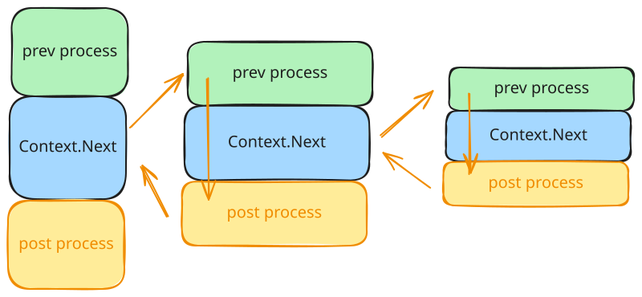
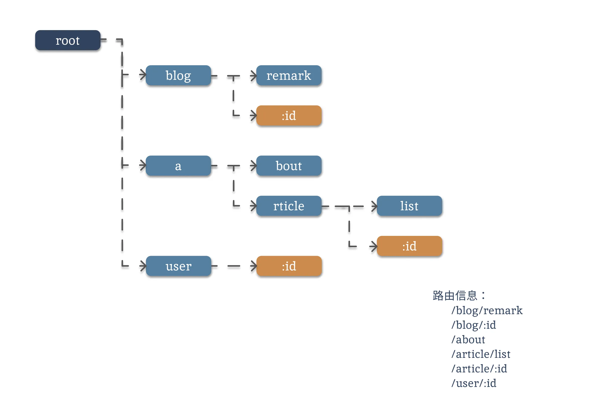
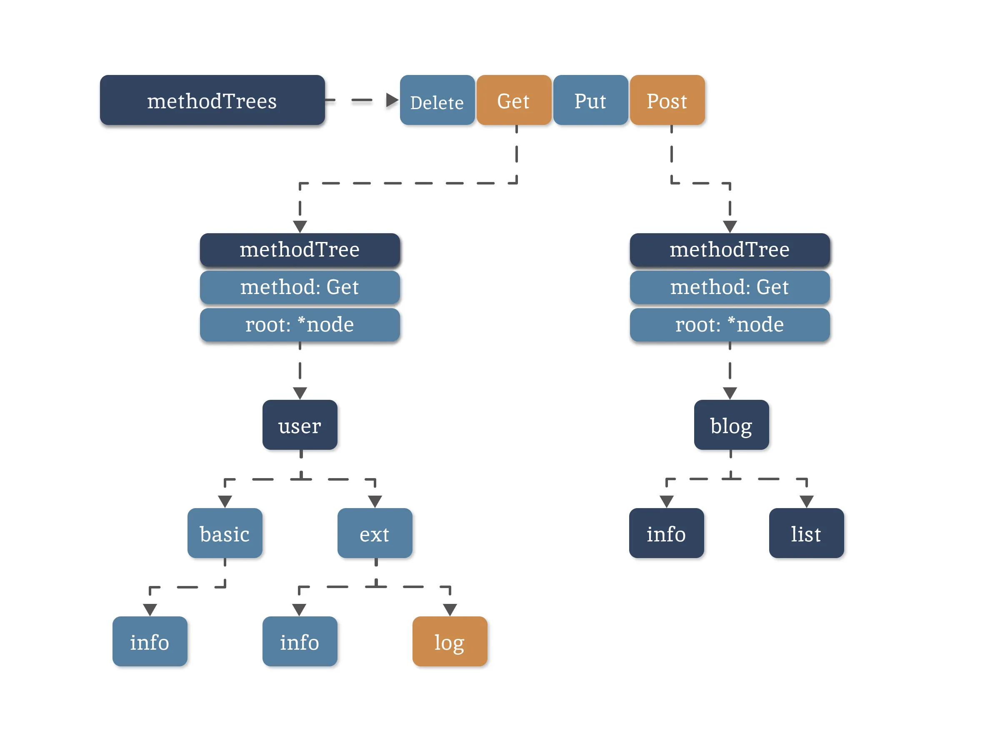

+++
date = '2025-08-11T20:43:32+08:00'
title = "开源系列--Gin"
tags = ["go"]
categories = ["opensource"]
+++

Gin 是 Golang 世界里最流行的 web 框架，于 github 开源：https://github.com/gin-gonic/gin


## 1. quickstart
```go
package main

import (
  "log"
  "net/http"

  "github.com/gin-gonic/gin"
)

func main() {
  // Create a Gin router with default middleware (logger and recovery)
  r := gin.Default()

  // Define a simple GET endpoint
  r.GET("/ping", func(c *gin.Context) {
    // Return JSON response
    c.JSON(http.StatusOK, gin.H{
      "message": "pong",
    })
  })

  // Start server on port 8080 (default)
  // Server will listen on 0.0.0.0:8080 (localhost:8080 on Windows)
  if err := r.Run(); err != nil {
    log.Fatalf("failed to run server: %v", err)
  }
}
```

运行应用程序：

1. 将以上代码保存为main.go
2. 运行应用程序：`go run main.go`
3. 打开浏览器并访问http://localhost:8080/ping
4. 你应该看到：{"message":"pong"}

这个例子说明了什么：

- 创建带有默认中间件的 Gin 路由器
- 使用简单的处理函数定义 HTTP 端点
- 返回 JSON 响应
- 启动 HTTP 服务器


## 2. 核心数据结构

### 2.1 gin.Engine

```go
// Engine 是框架的实例，它包含多路复用器、中间件和配置设置。
// 使用 New() 或 Default() 创建 Engine 实例
type Engine struct {
	RouterGroup

	// RedirectTrailingSlash 启用自动重定向功能，如果当前路由无法匹配，但存在带有（或不带）尾部斜杠的路由处理程序。
	// 例如，如果请求的是 /foo/，但路由只存在于 /foo，则
	// 对于 GET 请求，客户端将以 HTTP 状态码 301 重定向到 /foo；
	// 对于所有其他请求方法，则以状态码 307 重定向。
	RedirectTrailingSlash bool

	// RedirectFixedPath 如果启用，当没有注册处理程序时，路由器会尝试修复当前请求路径。
	// 首先移除多余的路径元素，如 ../ 或 //。
	// 然后路由器对清理后的路径进行不区分大小写的查找。
	// 如果能找到该路由的处理程序，路由器会将请求重定向
	// 到修正后的路径，GET 请求使用状态码 301，
	// 所有其他请求方法使用状态码 307。
	// 例如 /FOO 和 /..//Foo 可以被重定向到 /foo。
	// RedirectFixedPath 与 RedirectTrailingSlash 选项相互独立。
	RedirectFixedPath bool

	// HandleMethodNotAllowed 如果启用，当当前请求无法路由时，路由器会检查当前路由是否允许其他方法。
	// 如果是这种情况，请求将返回 'Method Not Allowed' 和 HTTP 状态码 405。
	// 如果没有其他允许的方法，请求将被委托给 NotFound 处理程序。
	HandleMethodNotAllowed bool

	// ForwardedByClientIP 如果启用，将从与 `(*gin.Engine).RemoteIPHeaders` 中存储的
	// 匹配的请求头中解析客户端 IP。如果未获取到 IP，则回退到从
	// `(*gin.Context).Request.RemoteAddr` 获取的 IP。
	ForwardedByClientIP bool

	// AppEngine 已弃用。
	// 已弃用：请使用值为 `gin.PlatformGoogleAppEngine` 的 `TrustedPlatform` 代替
	// #726 #755 如果启用，它将信任一些以 'X-AppEngine...' 开头的头部，
	// 以便更好地与该 PaaS 平台集成。
	AppEngine bool

	// UseRawPath 如果启用，将使用 url.RawPath 来查找参数。
	UseRawPath bool

	// UnescapePathValues 如果为 true，路径值将被取消转义。
	// 如果 UseRawPath 为 false（默认值），则 UnescapePathValues 实际上为 true，
	// 因为将使用 url.Path，它已经是未转义的。
	UnescapePathValues bool

	// RemoveExtraSlash 即使有额外的斜杠，也可以从 URL 中解析参数。
	// 参见 PR #1817 和 issue #1644
	RemoveExtraSlash bool

	// RemoteIPHeaders 当 `(*gin.Engine).ForwardedByClientIP` 为 `true` 且
	// `(*gin.Context).Request.RemoteAddr` 匹配由 `(*gin.Engine).SetTrustedProxies()` 
	// 定义的网络起源列表中的至少一个时，用于获取客户端 IP 的头部列表。
	RemoteIPHeaders []string

	// TrustedPlatform 如果设置为 gin.Platform* 常量值，则信任该平台设置的头部，
	// 例如用于确定客户端 IP
	TrustedPlatform string

	// MaxMultipartMemory 传递给 http.Request 的 ParseMultipartForm 方法调用的 'maxMemory' 参数值。
	MaxMultipartMemory int64

	// UseH2C 启用 h2c 支持。
	UseH2C bool

	// ContextWithFallback 当 Context.Request.Context() 不为 nil 时，启用后备的 
	// Context.Deadline()、Context.Done()、Context.Err() 和 Context.Value()。
	ContextWithFallback bool

	delims           render.Delims
	secureJSONPrefix string
	HTMLRender       render.HTMLRender
	FuncMap          template.FuncMap
	allNoRoute       HandlersChain
	allNoMethod      HandlersChain
	noRoute          HandlersChain
	noMethod         HandlersChain
	pool             sync.Pool
	trees            methodTrees
	maxParams        uint16
	maxSections      uint16
	trustedProxies   []string
	trustedCIDRs     []*net.IPNet
}
```

带有明确注释的字段无一例外都是配置向，他们的解释也非常明确，基本上是路径匹配和全局配置等。相关常用的几个默认项为：

```
// - RedirectTrailingSlash:  true
// - RedirectFixedPath:      false
// - HandleMethodNotAllowed: false
// - ForwardedByClientIP:    true
// - UseRawPath:             false
// - UnescapePathValues:     true
```

除去一些配置字段，剩下的都是一些基本字段了，我们分块说明。

#### 2.1.1 路由

```go
RouterGroup  // 内嵌路由组，支持分组路由管理
trees        methodTrees  // 按HTTP方法分类的路由树（Radix Tree）
```

可以认为整个主引擎就继承自路由组，这样可以直接使用路由相关的组件功能，比如 Get、Post 等等。其中trees 是一个相对复杂的结构，它用的是压缩前缀树,这个之后会说明。

```go
// RouterGroup 用于内部配置路由器，每个 RouterGroup 都与一个前缀和一组处理器（中间件）相关联。
type RouterGroup struct {
	Handlers HandlersChain
	basePath string
	engine   *Engine
	root     bool
}
```

RouterGroup 是路由组的概念，其中的配置将被从属于该路由组的所有路由复用：

• Handlers：路由组共同的 handler 处理函数链. 组下的节点将拼接 RouterGroup 的公用 handlers 和自己的 handlers，组成最终使用的 handlers 链
• basePath：路由组的基础路径. 组下的节点将拼接 RouterGroup 的 basePath 和自己的 path，组成最终使用的 absolutePath
• engine：指向路由组从属的 Engine
• root：标识路由组是否位于 Engine 的根节点. 当用户基于 RouterGroup.Group 方法创建子路由组后，该标识为 false

```go
type HandlersChain []HandlerFunc

type HandlerFunc func(*Context)
```

`HandlersChain` 是由多个路由处理函数 `HandlerFunc` 构成的处理函数链。 在使用的时候，会按照索引的先后顺序依次调用 `HandlerFunc`.


#### 2.1.2 异常路由处理

```go
HandleMethodNotAllowed bool  // 处理Method Not Allowed (405)
allNoRoute             HandlersChain  // 全局404处理器
allNoMethod            HandlersChain  // 全局405处理器
noRoute                HandlersChain  // 分组404处理器
noMethod               HandlersChain  // 分组405处理器
```

这几个参数是用来处理一些错误请求，比如不存在，或者没权限等等这种。它的使用也比较简单：

```go
router.NoRoute(func(c *gin.Context) {
    c.JSON(404, gin.H{"error": "Page not found"})
})
```

> 可以利用这一块的特性，设置中间件记录 404 和 405 的请求情况。


#### 2.1.3 模板渲染

```go
delims           render.Delims      // 模板分隔符
secureJSONPrefix string             // JSONP安全前缀，用来跨域的
HTMLRender       render.HTMLRender  // HTML渲染器
FuncMap          template.FuncMap   // 模板函数映射
```

这几个参数都是用来定义 HTML 模板的，通过不同的参数可以让 Gin 支持 HTML、XML 等等，但是前后端分离已经非常成熟，我们现在几乎用不到 Gin 来渲染页面。

#### 2.1.4 客户端IP限制

```go
ForwardedByClientIP bool     // 从请求头解析客户端IP
RemoteIPHeaders     []string // 用于解析IP的请求头列表
TrustedPlatform     string   // 信任特定平台的IP头（如Google App Engine）

trustedProxies   []string //信任IP地址
```

可以通过配置 IP 白名单，防止伪造 IP 或者一些特殊的网络攻击。

#### 2.1.5 对象池sync.Pool

这个是用来复用gin.Context的，每一个http请求都会分配一个gin.Context实例，作为一个服务端，接收到的请求数量是巨大的，那gin.Context的实例的创造和销毁都是一笔巨大的开销，而sync.Pool就是为了解决这个问题，具体可以参考之前写过的文章[Go并发控制：sync.Pool](./Go并发控制：sync.Pool.md)

### 2.2 主引擎启动

#### 2.2.1 初始化

gin 的初始化主要有两个函数，New()和 Default()，但是实际上用的都是 New():

```go
func New() *Engine {
	debugPrintWARNINGNew()
	engine := &Engine{
		RouterGroup: RouterGroup{
			Handlers: nil,
			basePath: "/",
			root:     true,
		},
		FuncMap:                template.FuncMap{},
		RedirectTrailingSlash:  true,
		RedirectFixedPath:      false,
		HandleMethodNotAllowed: false,
		ForwardedByClientIP:    true,
		RemoteIPHeaders:        []string{"X-Forwarded-For", "X-Real-IP"},
		TrustedPlatform:        defaultPlatform,
		UseRawPath:             false,
		RemoveExtraSlash:       false,
		UnescapePathValues:     true,
		MaxMultipartMemory:     defaultMultipartMemory,
		trees:                  make(methodTrees, 0, 9),
		delims:                 render.Delims{Left: "{{", Right: "}}"},
		secureJSONPrefix:       "while(1);",
		trustedProxies:         []string{"0.0.0.0/0", "::/0"},
		trustedCIDRs:           defaultTrustedCIDRs,
	}
	engine.RouterGroup.engine = engine
	engine.pool.New = func() any {
		return engine.allocateContext(engine.maxParams)
	}
	return engine
}

func Default() *Engine {
	debugPrintWARNINGDefault()
	engine := New()
	engine.Use(Logger(), Recovery())
	return engine
}
```

通过代码可以看出default 方法实际上在原有主引擎的基础上，加上了两个自带的中间件，日志和异常回收，关于这两个中间件，我们也会在中间件里面详细展开。

- `RouterGroup`字段的`basepath = /`表示根路径，同时`root=true`表明这是根节点。
- `trees`字段的初始化可以看到是`make(methodTrees, 0, 9)`,容量是9，其实就是对应的http的9中方法。
- `pool.New`是对象池的关于需要管理的对象的构造方法

> http的9种方法：Get/Post/Delete/Patch/Put/Options/Head/Any/Match

#### 2.2.2 服务启动

gin 可以支持多种服务类型，用的最多是 Run 方法：

```go
func (engine *Engine) Run(addr ...string) (err error) {
	defer func() { debugPrintError(err) }()

    //判断下受信任的IP
	if engine.isUnsafeTrustedProxies() {
		debugPrint("[WARNING] You trusted all proxies, this is NOT safe. We recommend you to set a value.\n" +
			"Please check https://pkg.go.dev/github.com/gin-gonic/gin#readme-don-t-trust-all-proxies for details.")
	}

    //将IP端口合并
	address := resolveAddress(addr)
	debugPrint("Listening and serving HTTP on %s\n", address)
    //注意，gin底层的http 使用的还是官方包，这个方法的Handler方法，底层其实是ServeHTTP
	err = http.ListenAndServe(address, engine.Handler())
	return
}

// ServeHTTP conforms to the http.Handler interface.
// 这个方法才是真正接收请求，处理服务的地方
func (engine *Engine) ServeHTTP(w http.ResponseWriter, req *http.Request) {
	// 从对象池中获取一个context
	c := engine.pool.Get().(*Context)

	// 重置 /初始化 context
	c.writermem.reset(w)
	c.Request = req
	c.reset()

	// 处理http请求
	engine.handleHTTPRequest(c)

	// 把context放回对象池
	engine.pool.Put(c)
}
```

> 为什么不在放回前充值context？这个问题其实是`sync.Pool`推崇的最佳实践：**"Resetting on Get is safer because it ensures the object is always in a known state before use, regardless of whether the previous user properly reset it before putting it back." **。也就是说，在 Get 时重置更安全，因为它不依赖于之前的使用者是否正确清理了对象。

可以看出Gin的启动其实就是依靠的`net/http`包，而Gin.Engine可以看做就是`http.Handler`接口的一种实现，因为实现了`ServeHTTP(ResponseWriter,*Request)`这个方法。

```go
func (engine *Engine) handleHTTPRequest(c *Context) {
	// 1. 获取请求方法和路径
	httpMethod := c.Request.Method
	rPath := c.Request.URL.Path
	
	// 初始化路径解析选项
	unescape := false
	// 如果引擎配置了使用原始路径（RawPath），且 RawPath 不为空
	if engine.UseRawPath && len(c.Request.URL.RawPath) > 0 {
		rPath = c.Request.URL.RawPath // 使用未解码的原始路径
		unescape = engine.UnescapePathValues // 根据配置决定是否对路径值进行反编码
	}

	// 如果启用了移除多余斜杠的功能，清理路径中的重复斜杠（如 //user///id -> /user/id）
	if engine.RemoveExtraSlash {
		rPath = cleanPath(rPath)
	}

	// 2. 在路由树中查找匹配的路由
	// Gin 为每种 HTTP 方法（GET, POST 等）维护了一棵独立的路由树（radix tree）
	t := engine.trees
	for i, tl := 0, len(t); i < tl; i++ {
		// 跳过不匹配的 HTTP 方法
		if t[i].method != httpMethod {
			continue
		}
		
		// 获取当前方法对应的路由树根节点
		root := t[i].root
		
		// 在路由树中查找与请求路径匹配的值
		// value.handlers: 匹配到的处理函数链（中间件 + handler）
		// value.params: 提取的路径参数（如 /user/:id 中的 id）
		// value.tsr: Tailing Slash Redirect，是否因为尾部斜杠不同而需要重定向
		value := root.getValue(rPath, c.params, c.skippedNodes, unescape)
		
		// 如果提取到了路径参数，将其赋值给 Context
		if value.params != nil {
			c.Params = *value.params
		}
		
		// 如果找到了匹配的处理函数链
		if value.handlers != nil {
			// 将处理链赋值给 Context
			c.handlers = value.handlers
			// 记录完整的路由模式（如 /user/:id），用于监控或日志
			c.fullPath = value.fullPath
			
			// 执行处理链：依次调用中间件和最终的 handler
			c.Next()
			
			// 确保响应头已被写入（如果 handler 中没有显式写入状态码，这里会写入默认 200）
			c.writermem.WriteHeaderNow()
			return // 请求处理完成，直接返回
		}
		
		// 3. 处理未找到精确匹配的情况（尝试重定向）
		// Connect 方法和根路径 "/" 不进行重定向处理
		if httpMethod != http.MethodConnect && rPath != "/" {
			// 情况 A: 尾部斜杠不匹配（如请求 /user/ 但注册的是 /user）
			if value.tsr && engine.RedirectTrailingSlash {
				redirectTrailingSlash(c) // 执行 301/302 重定向
				return
			}
			
			// 情况 B: 路径固定化重定向（如请求 /user//id 但注册的是 /user/:id）
			if engine.RedirectFixedPath && redirectFixedPath(c, root, engine.RedirectFixedPath) {
				return
			}
		}
		
		// 如果当前方法树中没有找到匹配，跳出循环（不再检查其他方法的树）
		break
	}

	// 4. 处理方法不允许（405 Method Not Allowed）
	// 如果启用了 HandleMethodNotAllowed，且上面没有找到匹配的路由
	if engine.HandleMethodNotAllowed {
		// 遍历所有其他 HTTP 方法的路由树
		for _, tree := range engine.trees {
			// 跳过当前请求的方法（已经检查过了）
			if tree.method == httpMethod {
				continue
			}
			
			// 在其他方法的树中查找相同路径是否存在
			if value := tree.root.getValue(rPath, nil, c.skippedNodes, unescape); value.handlers != nil {
				// 如果存在，说明路径正确但方法错误
				// 设置处理链为全局的 405 错误处理函数
				c.handlers = engine.allNoMethod
				// 返回 405 状态码和默认错误 body
				serveError(c, http.StatusMethodNotAllowed, default405Body)
				return
			}
		}
	}
	
	// 5. 处理未找到路由（404 Not Found）
	// 如果以上所有检查都失败，则视为 404
	// 设置处理链为全局的 404 错误处理函数
	c.handlers = engine.allNoRoute
	// 返回 404 状态码和默认错误 body
	serveError(c, http.StatusNotFound, default404Body)
}
```

**核心流程总结：**
1. **预处理路径：** 根据配置决定使用 Path 还是 RawPath，并清理多余斜杠。
2. **路由匹配：** 在对应 HTTP 方法的路由树（Radix Tree）中查找匹配项。
3. **匹配成功：** 执行 c.Next() 运行处理链，然后返回。
4. **尾部斜杠问题：** 如果启用重定向，则返回 301/302。
5. **405 检查：** 如果没匹配到，但其他方法有该路径，返回 405。
5. **404 处理：** 如果彻底没找到，返回 404。

### 2.3 Middleware中间件

#### 2.3.1 面向切片编程(AOP)

用官方的话术讲什么是AOP：AOP（Aspect-Oriented Programming，面向切面编程）是一种编程范式，用于将横切关注点（Cross-cutting Concerns）与主要业务逻辑分离。横切关注点是指那些存在于应用程序中多个不同部分的功能，例如日志，鉴权等，它们跨越多个模块和对象。

用比较通俗的说法讲就是：AOP 的核心思想是通过将横切关注点从主要业务逻辑中分离出来，然后以`模块化`的方式进行管理和重用。这样可以提高代码的可维护性、可扩展性和可重用性。

绝大多数的现代框架的中间件模块都是基于AOP的思想来设计的。

#### 2.3.2 函数链HandlersChain

```go
// HandlerFunc 定义了一个中间件函数的标准方法，入参必须带有Context,这是我们前面讲过得gin框架自己定义的Context
type HandlerFunc func(*Context)

// HandlersChain 核心，通过切片的方式存储函数链
type HandlersChain []HandlerFunc

// Last 函数链的唯一方法。获取链上最后一个函数，通常情况下最后一个函数就是我们自己定义的真正要处理业务的函数。
func (c HandlersChain) Last() HandlerFunc {
	if length := len(c); length > 0 {
		return c[length-1]
	}
	return nil
}

//另外需要注意的是，函数链作为RouterGroup的一个属性，存储在路由器的节点上。
//后续我们调用的use方法，都是RouterGroup的所提供的方法。
type RouterGroup struct {
	Handlers HandlersChain //函数链
	basePath string
	engine   *Engine
	root     bool
}
```

函数链的构成非常简单，底层就是一个`切片`，对函数链的操作直接变成了对切片的操作。当我们新增一个中间件时：

```go
func (group *RouterGroup) Use(middleware ...HandlerFunc) IRoutes {
	//非常简单的操作，将中间件方法Append到Handlers中
	group.Handlers = append(group.Handlers, middleware...)
	return group.returnObj()
}

// Group 该方法会返回一个全新的RouterGroup，并且会继承父Group的一些属性
func (group *RouterGroup) Group(relativePath string, handlers ...HandlerFunc) *RouterGroup {
	return &RouterGroup{
		//将多个中间件按照顺序组合到一起
		Handlers: group.combineHandlers(handlers),
		//将父级的路径组合到一起
		basePath: group.calculateAbsolutePath(relativePath),
		//把主引擎的指针继续传递下去
		engine: group.engine,
	}
}

//这里需要重点说下，父Group的中间件是如何传递给子Group的
// combineHandlers 将一个函数链和父级的函数链结合，返回一个新的函数链
func (group *RouterGroup) combineHandlers(handlers HandlersChain) HandlersChain {
	//计算当前函数链的总长度
	finalSize := len(group.Handlers) + len(handlers)
	//判断函数链的总长度是否大于最大长度，默认是63
	assert1(finalSize < int(abortIndex), "too many handlers")
	//定义一个新的切片，直接设置需要的切片容量，后续不会再触发扩容操作（切片使用的一个小技巧）
	mergedHandlers := make(HandlersChain, finalSize) 
	//先将父级的函数链复制进来，注意这里用的是copy，既完成内存复制还能保证顺序
	copy(mergedHandlers, group.Handlers)
	//再将新的函数链复制到父级函数链之后
	copy(mergedHandlers[len(group.Handlers):], handlers)
	//如此一来，新的函数链内存是新的，顺序也符合预期。
	return mergedHandlers
}
```

至于新增一个路由，则会在当前group的函数链的基础上再加上业务方法构成新的函数链：

```go
// handle 新增一个路由方法时会调用这个方法，它把最终生成的函数链保存在路由树的叶子接点上
func (group *RouterGroup) handle(httpMethod, relativePath string, handlers HandlersChain) IRoutes {
	//获取当前的绝对路径
	absolutePath := group.calculateAbsolutePath(relativePath)
	//将业务方法 handlers 和Group中的中间件函数链组合起来 
	handlers = group.combineHandlers(handlers)
	//将方法 ，路径，函数链添加到路由树里
	group.engine.addRoute(httpMethod, absolutePath, handlers)
	return group.returnObj()
}
```

#### 2.3.3 Next() Abort()

```go
//我们在路由中讲到过，请求过来后会经过handleHTTPRequest方法，当匹配到一个路由时，会走下面这段逻辑：
func (engine *Engine) handleHTTPRequest(c *Context) {
	...
	//匹配到一个路由后，如果函数链不为空
	if value.handlers != nil {
		//把函数链赋值给当前Context
		c.handlers = value.handlers
		//把绝对路径赋值给当前Context
		c.fullPath = value.fullPath
		//核心，开始按照函数链中的顺序执行，Context可以参与到函数链的每一步操作中
		//另外的，Gin框架中的核心几乎都离不开Context。
		c.Next()
		//丰富一下Response的Header
		c.writermem.WriteHeaderNow()
		return
	}
	...
}

// Next 函数链操作的核心，也是洋葱模式的一种实现方式
func (c *Context) Next() {
	//index 初始值为-1，第一次后为0，为函数链第一个
	c.index++
	//遍历执行所有的函数链
	for c.index < int8(len(c.handlers)) {
		//核心，c.handlers[c.index]其实就是函数链里的第c.index个函数，(c)则是将Context作为参数传值
		//正是这一步在执行中间件方法和业务方法。
		//如果某个中间件中调用了Abort()，会直接终止for循环
		c.handlers[c.index](c)
		//将索引向后移
		c.index++
	}
}

// Abort 用来将函数链的索引设置为最大值，会终止函数链的执行
const abortIndex int8 = math.MaxInt8 >> 1
func (c *Context) Abort() {
	c.index = abortIndex
}
```



我们举一个例子来理解下中间件的运行：

```go
func TestMid() {
	r := gin.Default()
	//在这里使用了三个中间件
	r.Use(mid1(), mid2(), mid3())
	r.GET("/abc", func(context *gin.Context) {
		fmt.Println("关注香香编程喵喵喵")
	})
	_ = r.Run(":8081")
}

func mid1() gin.HandlerFunc {
	return func(c *gin.Context) {
		fmt.Println("1. A-前")
		c.Next() // 触发第二层 c.Next()
		fmt.Println("5. A-后")
	}
}
func mid2() gin.HandlerFunc {
	return func(c *gin.Context) {
		fmt.Println("2. B-前")
		c.Next() // ★ 触发第三层 c.Next()
		fmt.Println("4. B-后")
	}
}

func mid3() gin.HandlerFunc {
	return func(c *gin.Context) {
		fmt.Println("3. 业务逻辑")
		//这里不执行next
		//c.Next()
	}
}
```

执行结果是：
```shell
1. A-前
2. B-前
3. 业务逻辑
4. B-后
5. A-后
```

1. 第一层 c.Next()：index 变成 0。执行 handlers[0](c)，即调用函数 A。
	- 进入函数 A：打印 "1. A-前"。
	- 遇到 c.Next()，函数 A 暂停在这里，等待 c.Next() 返回。
2. 进入第二层 c.Next()：index 变成 1。执行 handlers[1](c)，即调用函数 B。
	- 进入函数 B：打印 "2. B-前"。
	- 遇到 c.Next()，函数 B 暂停在这里，等待 c.Next() 返回。
3. 进入第三层 c.Next()：index 变成 2。执行 handlers[2](c)，即调用函数 Handler。
	- 进入函数 Handler：打印 "3. 业务逻辑"。
	- 没有 c.Next()，函数执行到末尾，函数 Handler 结束（return）。
4. 回到第三层 c.Next()：因为 Handler 已经 return 了，控制权回到第三层 c.Next() 的 for 循环里。
	- 执行 c.index++（index 变成 3）。3 不小于 3，循环结束，第三层 c.Next() 结束（return）
5. 回到函数 B：因为 B 里面的 c.Next() 返回了，函数 B 被唤醒，继续执行 c.Next() 的下一行代码。打印 "4. B-后"。函数 B 执行到末尾，函数 B 结束（return）。
6. 回到第二层 c.Next()：因为 B 已经 return 了，控制权回到第二层 c.Next() 的 for 循环里。执行 c.index++（index 变成 4）。循环结束，第二层 c.Next() 结束（return）。
7. 回到函数 A：因为 A 里面的 c.Next() 返回了，函数 A 被唤醒，继续执行 c.Next() 的下一行代码。打印 "5. A-后"。函数 A 执行到末尾，函数 A 结束（return）。


### 2.4 Router路由器

#### 2.4.1 接口设计

首先，我们先来看下路由接口的设计：

```go
// IRouter 路由组的核心接口，本质是路由接口和Group方法的组合。
//这个接口的设计就是我们之前提到过的"小接口的组合"的思维。
type IRouter interface {
	IRoutes                                    //路由接口
	Group(string, ...HandlerFunc) *RouterGroup //分组方法，用来获取一新的RouterGroup
}

// IRoutes 路由的核心接口，我们常用的GET，POST方法都由这个接口提供。
//注意，这些方法的返回值都是一个IRoutes接口，这个接口往往是其本身。这样可以实现简单的链式调用
type IRoutes interface {
	Use(...HandlerFunc) IRoutes //向当前路由组添加中间件
	// Handle 根据传入的具体方法，注册一组路由
	Handle(string, string, ...HandlerFunc) IRoutes 
	// Any 唯一需要注意的，这个方法会一次创建所有类型的路由
	Any(string, ...HandlerFunc) IRoutes            
	GET(string, ...HandlerFunc) IRoutes
	POST(string, ...HandlerFunc) IRoutes
	DELETE(string, ...HandlerFunc) IRoutes
	PATCH(string, ...HandlerFunc) IRoutes
	PUT(string, ...HandlerFunc) IRoutes
	OPTIONS(string, ...HandlerFunc) IRoutes
	HEAD(string, ...HandlerFunc) IRoutes
	Match([]string, string, ...HandlerFunc) IRoutes

	//静态资源相关的方法，用的不多。
	StaticFile(string, string) IRoutes
	StaticFileFS(string, string, http.FileSystem) IRoutes
	Static(string, string) IRoutes
	StaticFS(string, http.FileSystem) IRoutes
}
```

然后，我们看下RouterGroup是如何实现IRouter的接口的：

```go
type RouterGroup struct {
	// Handlers 一个函数链，底层是一个数组，装的是中间件的方法，子Group会继承父的中间件
	Handlers HandlersChain
	// basePath 定义的Group的主路径
	basePath string
	// engine 核心引擎的指针。需要注意，基于主Group创造出来的子Group们不仅会使用主中间件还会共用一个主引擎
	engine *Engine
	// root 是否为根Group，只有我们New出来的主引擎自带的Group这里才会是true
	root bool
}
```

最后，RouterGroup里有几个核心方法，我们可以学习一下，看他具体是如何工作的：

```go
func (group *RouterGroup) Use(middleware ...HandlerFunc) IRoutes {
	//非常简单的操作，将中间件方法Append到Handlers中
	group.Handlers = append(group.Handlers, middleware...)
	return group.returnObj()
}

// Group 该方法会返回一个全新的RouterGroup，并且会继承父Group的一些属性
func (group *RouterGroup) Group(relativePath string, handlers ...HandlerFunc) *RouterGroup {
	return &RouterGroup{
		//将多个中间件按照顺序组合到一起，底层使用的是内存copy,我们讲到中间件时会展开
		Handlers: group.combineHandlers(handlers),
		//将父级的路径组合到一起
		basePath: group.calculateAbsolutePath(relativePath),
		//把主引擎的指针继续传递下去
		engine: group.engine,
	}
}

// handle 核心中的核心。POST，GET等注册路由器方法的底层函数。
func (group *RouterGroup) handle(httpMethod, relativePath string, handlers HandlersChain) IRoutes {
	//获取当前的绝对路径相当于 Group的路径加上传入的路径
	absolutePath := group.calculateAbsolutePath(relativePath)
	//将当前函数和Group的中间件函数们串起来，得到一个新的切片
	handlers = group.combineHandlers(handlers)
	//将上述获得的绝对路径+方法链注册到路由树里。注意这里调用的是主引擎的addRoute方法。也就是说，路由树的管理权在主引擎手上。
	group.engine.addRoute(httpMethod, absolutePath, handlers)
	return group.returnObj()
}

// returnObj 函数定义是返回一个接口，实际返回的是自身。这是实现链式操作的一种方式
func (group *RouterGroup) returnObj() IRoutes {
	//root 字段的唯一用处，在根Group的情况下，返回主引擎。
	if group.root {
		return group.engine
	}
	return group
}
```

> 注意，整个RouterGroup只负责绑定路由树，不负责匹配。

#### 2.4.2 压缩前缀树

在Gin框架中路由的前缀树如下：



```go
type methodTree struct {
	method string //方法类型：GET，POST等
	root   *node  //方法类型对应的具体路由树
}

type methodTrees []methodTree //主引擎中存储的路由树

// node 树的节点结构，适当调整了下字段顺序
type node struct {
	path      string // 节点路径，比如上面的blog，a，bout等等
	fullPath  string //完整路径
	wildChild bool   //通配符标识,比如带有:id的节点，这个值就是true

	//字母索引，对应的就是上边的a，下面的about和article的b和r
	//也就意味着，这个分支下面还有至少两个分支
	indices string
	//优先级，当前节点的子节点越多，这个值会越大
	priority uint32
	//当前节点的所有子节点
	children []*node
	//节点类型 有四种 static root param catchAll
	// static: 静态节点（默认），
	// root: 根节点
	// catchAll: 带有通配符的节点，也就是*
	// param: 参数节点
	nType nodeType

	handlers HandlersChain //函数链

}
```



对于树的节点`node`而言，它包含几个维护自身的方法，整体比较复杂（树节点的添加和再平衡本来就挺复杂的，好在前缀树没有删除某个节点的操作），比较重要的是：

1. `addRoute`我们添加路由时，主引擎也会调用该方法将该节点添加到前缀树上。
2. `getValue`我们请求过来后，会调用这个方法从树上找到具体的节点。

```go
func (engine *Engine) addRoute(method, path string, handlers HandlersChain) {
	...
	// 获取请求方法对应的树
	root := engine.trees.get(method)
	if root == nil {
		//不存在的话，就创建一个该类型的树。
		root = new(node)
		root.fullPath = "/"
		engine.trees = append(engine.trees, methodTree{method: method, root: root})
	}
	//将当前路径和方法添加到前缀树里。
	root.addRoute(path, handlers)
	...
}

func (n *node) addRoute(path string, handlers HandlersChain) {
	fullPath := path
	//对路由树的 priority 属性进行自增操作，表示在此路由树中添加了一个新的节点。
	n.priority++

	// 如果路由树还没有任何节点，那么直接将传入的路由路径和处理函数添加到当前节点，此时路由树的类型被设置为 root。
	if len(n.path) == 0 && len(n.children) == 0 {
		n.insertChild(path, fullPath, handlers)
		n.nType = root
		return
	}

	parentFullPathIndex := 0

walk:
	//该循环的作用是寻找当前路径最合适的插入位置，本质上就是一种树的遍历，遍历的同时，适当调整树的结构。
	for {
		//查找当前路由节点和传入的路由路径的最长公共前缀
		i := longestCommonPrefix(path, n.path)

		//如果发现有前缀，并且前缀和当前前缀还小，相当于从 abc->ab,就会触发节点的分裂
		if i < len(n.path) {
			//分裂为新的节点，主要是path发生变化
			...
		}

		// 创建一个当前路径的节点
		if i < len(path) {
			path = path[i:]
			c := path[0]

			// 处理参数类型后 还带有/的特殊情况，直接略过
			if n.nType == param && c == '/' && len(n.children) == 1 {
				...
				continue walk
			}

			// 按照前缀继续往下查，直到没有重复前缀为止 此时的节点就是我们需要添加的位置了
			for i, max := 0, len(n.indices); i < max; i++ {
				...
			}

			// 如果此时的路径还有东西，并且类型不是通配符，可以认为是一个正常类型 我们的about 就会走到这里
			if c != ':' && c != '*' && n.nType != catchAll {
				// 向父节点上添加上子路径的首字母
				n.indices += bytesconv.BytesToString([]byte{c})
				//构造一下子节点
				child := &node{
					fullPath: fullPath,
				}
				//向当前节点上增加一个子节点
				n.addChild(child)
				n.incrementChildPrio(len(n.indices) - 1)
				//将游标指向新节点，准备结束循环
				n = child
			} else if n.wildChild {
				// 如果是通配符类型的，需要检查下是否有冲突，整体逻辑类似
				...
			}
			//向当前节点插入一个路径，以上所有的操作都只是找到位置，这里才是真正的插入节点
			n.insertChild(path, fullPath, handlers)
			return
		}

		// 当前节点已经被注册过了
		if n.handlers != nil {
			panic("handlers are already registered for path '" + fullPath + "'")
		}
		//如果当前节点根本就不需要走前缀索引，那么直接就可以创建节点了
		n.handlers = handlers
		n.fullPath = fullPath
		return
	}
}
```

当我们匹配一个路由时，会使用到主引擎的`ServeHTTP`，它会调用`handleHTTPRequest`方法，最后找到`node`的`getValue`方法。这个代码很长，我可以看下简化版本：

```go
func (n *node) getValue(path string, params *Params, skippedNodes *[]skippedNode, unescape bool) (value nodeValue) {
	var globalParamsCount int16

walk:
	// 遍历整棵树，第一次遍历时，n是根路径
	for {
		prefix := n.path
		//在前缀树里查一下当前路径的位置
		if len(path) > len(prefix) {
			//前缀能匹配上
			if path[:len(prefix)] == prefix {
				...
				// 遍历所有非通配符的节点
				for i, c := range []byte(n.indices) {
					...
				}

				// 非通配符节点
				if !n.wildChild {
					...
				}

				// 处理通配符节点
				n = n.children[len(n.children)-1]
				globalParamsCount++

				switch n.nType {
				case param:
					...
				case catchAll:
					...
				default:
					panic("invalid node type")
				}
			}
		}

		//匹配到了具体的节点
		if path == prefix {
			//如果当前节点没有handler 或者当前路径不是 就需要回滚到最后一个有效的skippedNode
			if n.handlers == nil && path != "/" {
				...
			}

			//如果当前节点有handler 就算是匹配到具体的路由了
			if value.handlers = n.handlers; value.handlers != nil {
				value.fullPath = n.fullPath
				return
			}

			...

			//继续查询带有/的节点
			for i, c := range []byte(n.indices) {
				...
			}

			return
		}

		//判定下value.tsr 的值，这是个赋值语句……
		value.tsr = path == "/" ||
			(len(prefix) == len(path)+1 && prefix[len(path)] == '/' &&
				path == prefix[:len(prefix)-1] && n.handlers != nil)

		// 回退到最近一个有效的节点
		if !value.tsr && path != "/" {
			...
		}

		return
	}
}
```

>前缀树的添加和匹配的操作都属于对树的遍历，本质上都是递归操作。


### 2.5 Gin.Context

#### 2.5.1 结构体字段

```go
type Context struct {
	writermem responseWriter
	Request   *http.Request
	Writer    ResponseWriter

	// URL相关
	Params   Params
	handlers HandlersChain
	index    int8
	fullPath string

	engine       *Engine
	params       *Params
	skippedNodes *[]skippedNode

	// 并发安全的让Context能够提供存储一些数据的能力。
	mu sync.RWMutex
	Keys map[string]any

	// Errors 是一个error的指针切片，用来存储使用该Context的方法和中间件所产生的Error
	Errors errorMsgs

	// Accepted 用来记录该路径允许请求的类型，就是header里的Accept
	Accepted []string

	// queryCache caches the query result from c.Request.URL.Query().
	queryCache url.Values

	// formCache caches c.Request.PostForm, which contains the parsed form data from POST, PATCH,
	// or PUT body parameters.
	formCache url.Values

	// SameSite allows a server to define a cookie attribute making it impossible for
	// the browser to send this cookie along with cross-site requests.
	sameSite http.SameSite
}
```

#### 2.5.2 实现context接口

```go
func (c *Context) Deadline() (deadline time.Time, ok bool) {
	// ContextWithFallback默认是false 一般都不会回退的。
	if !c.engine.ContextWithFallback || c.Request == nil || c.Request.Context() == nil {
		return
	}
	return c.Request.Context().Deadline()
}

// Done returns nil (chan which will wait forever) when c.Request has no Context.
func (c *Context) Done() <-chan struct{} {
	if !c.engine.ContextWithFallback || c.Request == nil || c.Request.Context() == nil {
		return nil
	}
	return c.Request.Context().Done()
}

// Err returns nil when c.Request has no Context.
func (c *Context) Err() error {
	if !c.engine.ContextWithFallback || c.Request == nil || c.Request.Context() == nil {
		return nil
	}
	return c.Request.Context().Err()
}

// Value 会优先返回元数据中的Key，如果没有才会尝试去Request中的Context中查询。
func (c *Context) Value(key any) any {
	//两种特殊情况
	if key == 0 {
		return c.Request //直接返回Request结构体
	}
	if key == ContextKey {
		return c //直接返回Context本身
	}
	if keyAsString, ok := key.(string); ok {
		if val, exists := c.Get(keyAsString); exists {
			return val
		}
	}
	if !c.engine.ContextWithFallback || c.Request == nil || c.Request.Context() == nil {
		return nil
	}
	return c.Request.Context().Value(key)
}
```

#### 2.5.3 

```go
func New() *Engine {
	engine := &Engine{
	...
	}
	//初始化生成一个Context的方法
	engine.pool.New = func() any {
		return engine.allocateContext(engine.maxParams)
	}
	return engine
}

//生成一个gin的Context
func (engine *Engine) allocateContext(maxParams uint16) *Context {
	v := make(Params, 0, maxParams) //声明一个Params的切片，并且直接定义好容量
	skippedNodes := make([]skippedNode, 0, engine.maxSections) 
	//返回一个gin的Context，注意此时的Context还不完整，不能直接使用。
	return &Context{engine: engine, params: &v, skippedNodes: &skippedNodes}
}
```

## 3. 优雅关闭

假如，我们正在请求一个接口，获取用户的个人信息，这个接口需要1秒钟的时间进行数据查询，回溯，拼接等逻辑，然后再返回给我们。在这一秒钟内，服务因为某些原因，出BUG了，Panic了，那么服务可能会爆出500的错误。

请求还没有结束，程序整体已经退出了。那么解决方法就是，程序退出时，先看下目前还有没有正在进行中的请求，延缓几秒钟，等请求都结束了，再退出。如果在延迟N秒的时候，又来了新的请求，则直接返回500.

那现在提供一个优雅关闭的案例，其实很多项目都能用的到这种方式。

```go
package main

import (
	"context"
	"log"
	"net/http"
	"os/signal"
	"syscall"
	"time"

	"github.com/gin-gonic/gin"
)

func main() {
	// 创建一个监听操作系统信号的Context
	ctx, stop := signal.NotifyContext(context.Background(), syscall.SIGINT, syscall.SIGTERM)
	defer stop()

	router := gin.Default()
	router.GET("/", func(c *gin.Context) {
		time.Sleep(10 * time.Second)
		c.String(http.StatusOK, "Welcome Gin Server")
	})

    //这里启动的是官方包的server，把gin的组件塞进去。
	srv := &http.Server{
		Addr:    ":8080",
		Handler: router,
	}

	//以协程的方式拉起服务，这样不会阻塞后续的优雅退出
	go func() {
		if err := srv.ListenAndServe(); err != nil && err != http.ErrServerClosed {
			log.Fatalf("listen: %s\n", err)
		}
	}()

	//监听操作系统的关闭信号
	<-ctx.Done()

	// Restore default behavior on the interrupt signal and notify user of shutdown.
	stop()
	log.Println("shutting down gracefully, press Ctrl+C again to force")

	//起一个5秒超时的Context，传递给srv，它可以实现在5秒之后关闭服务。
	ctx, cancel := context.WithTimeout(context.Background(), 5*time.Second)
	defer cancel()
	if err := srv.Shutdown(ctx); err != nil {
		log.Fatal("Server forced to shutdown: ", err)
	}

	log.Println("Server exiting")
}
```