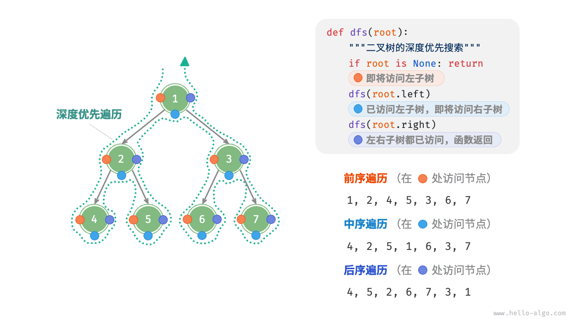
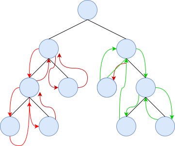
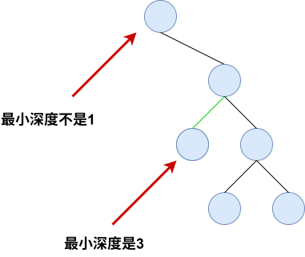
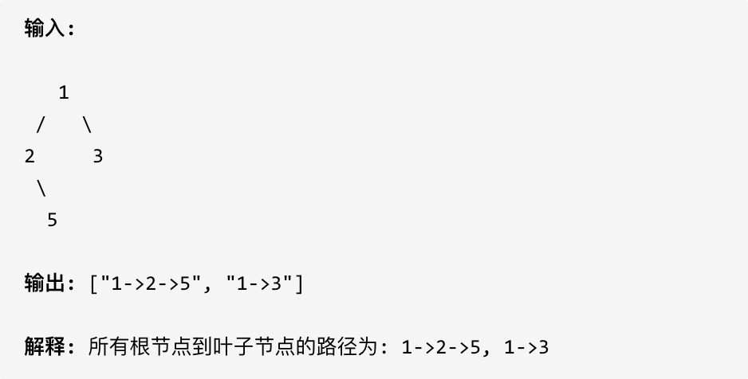

+++
date = '2026-04-12T09:16:15+08:00'
title = "二叉树：应用"
tags = ["数据算法"]
categories = ["数据算法"]
+++

在本文之前，必须要读[二叉树：理论基础](./二叉树：理论基础.md),这是一切问题的基石。尤其是二叉树的深度优先遍历的原理和方式。



递归遍历的本质是：

**每个节点都会被“经过三次机会”：进入时 / 左子树返回后 / 右子树返回后，在哪一步写代码，就决定是哪种遍历。“递”是进入函数栈深处；“归”是函数栈逐层返回。前序在“第一次进入节点时处理”，中序在“左子树返回后处理”，后序在“左右子树都返回后处理”。**


## 1. 二叉树翻转

### 题目描述

翻转一棵二叉树。


### 思路

翻转的过程就是交换左右节点的过程。也就是`node.left,node.right = node.right,node.left`

那什么时候翻转呢？

假设一个二叉树，要对A进行翻转

      A
     / \
    B   C

- **情况一：刚进入A就交换--前序**
```go
A.left, A.right = A.right, A.left

invert(A.left)
invert(A.right)
```
再进入A进行交换，就是

      A
     / \
    C   B

然后
```go
invert(A.left)
invert(A.right)
```
继续翻转，没有问题。

- **情况二：左子树处理完交换--中序**
```go
invert(A.left)
A.left, A.right = A.right, A.left
invert(A.right)
```
先递归左子树invert(B)

      A
     / \
    B   C

然后翻转A

      A
     / \
    C   B

然后递归右子树，是不是发现递归的还是B。

那这种情况在的中序遍历就不是那么合适。

- **情况二：左右子树都处理完交换--中序**

```go
invert(A.left)
invert(A.right)

A.left, A.right = A.right, A.left
```

一开始先递归左子树invert(B)

      A
     / \
    B   C

再递归右子树invert(C)

      A
     / \
    B   C

然后翻转操作

```go
A.left, A.right = A.right, A.left
```
流程是：
- 先翻转B
- 先翻转C
- 最后翻转A

**用“递归三次机会”来理解**

对于节点 A：

机会1：刚进入A
机会2：左子树返回
机会3：右子树返回

翻转操作：
```
A.left, A.right = A.right, A.left
```
放在哪里？

- 放在机会1（前序）
```
swap(A)
invert(left)
invert(right)
```
正确。

放在机会2（中序）
```
invert(left)
swap(A)
invert(right)
```
错误。

因为交换以后：

right 已经不是原来的 right

递归路线被改坏了。

放在机会3（后序）
```
invert(left)
invert(right)
swap(A)
```
正确。

因为，左右子树都已经处理完了此时交换不会影响任何后续递归。

```go
// 前序遍历
func invertTree(root *TreeNode) *TreeNode {
	if root == nil {
		return nil
	}
	root.Left, root.Right = root.Right, root.Left
	invertTree(root.Left)
	invertTree(root.Right)
	return root
}
```

其实完全按照递归三要素的解法：
1. **确定递归函数的参数和返回值**
    - 参数：本地要处理的节点
    - 返回值：执行动作的指令，不需要返回值
2. **确定终止条件**
3. **确定单层递归的逻辑**
    - 因为是前序遍历，所以先进行交换左右孩子节点，然后反转左子树，反转右子树。
```go
func invertTree(root *TreeNode) *TreeNode {
	invert(root)
	return root
}

func invert(node *TreeNode) {
	if node == nil {
		return
	}
	node.Left, node.Right = node.Right, node.Left
	invert(node.Left)
	invert(node.Right)
}
```

递归能做的，栈也能做，就是迭代法：

```go
type Node struct {
	treenode *TreeNode
	handled  int
}

func invertTree(root *TreeNode) *TreeNode {
	stack := make([]Node, 0)
	stack = append(stack, Node{root, 0})
	for len(stack) > 0 {
		node := stack[len(stack)-1]
		stack = stack[:len(stack)-1]
		if node.treenode == nil {
			continue
		}
		if node.handled == 0 {
			stack = append(stack, Node{node.treenode.Right, 0})
			stack = append(stack, Node{node.treenode.Left, 0})
			stack = append(stack, Node{node.treenode, 1})

		}
		if node.handled == 1 {
			node.treenode.Left, node.treenode.Right = node.treenode.Right, node.treenode.Left
		}
	}

	return root
}
```

其实本道题目也可以使用层序遍历。
```go
func invertTree(root *TreeNode) *TreeNode {
	if root == nil {
		return root
	}
	queue := list.New()
	queue.PushBack(root)
	for queue.Len() > 0 {
		length := queue.Len()
		for i := 0; i < length; i++ {
			node := queue.Remove(queue.Front()).(*TreeNode)
			node.Left, node.Right = node.Right, node.Left
			if node.Left != nil {
				queue.PushBack(node.Left)
			}
			if node.Right != nil {
				queue.PushBack(node.Right)
			}
		}
	}
	return root
}
```


## 2. 对称二叉树

其实对称二叉树与题[二叉树翻转](#1-二叉树翻转)是一个整体观。

这里为什么要说是整体观呢，因为如果是对称二叉树，那么二叉树翻转后与原始的树是一模一样的，但是如果直接翻转二叉树，那树的结构变了，原始的二叉树就丢了，那本题只是一个判断行为，不需要修改树结构。


所以只是判断的话，就要思考对称的现象，千万不要想成左子树是否等于右子树，而是根的左子树和右子树是否互为镜像。

画图判断镜像：



从图可以看出，其实是两棵树的遍历路线的不同

```go
func isSymmetric(root *TreeNode) bool {
	if root == nil {
		return true
	}
	var dfs func(left, right *TreeNode) bool
	dfs = func(left, right *TreeNode) bool {
		// 1. 两个都是nil → 对称
		if left == nil && right == nil {
			return true
		}
		// 2. 其中一个是nil → 不对称
		if left == nil || right == nil {
			return false
		}
		// 3. 走到这里，left和right都不可能是nil，安全访问
		if left.Val != right.Val {
			return false
		}
		return dfs(left.Left, right.Right) && dfs(left.Right, right.Left)
	}
	return dfs(root.Left, root.Right)
}
```

## 3. 二叉树的最大深度

### 题目描述

给定一个二叉树，找出其最大深度。

二叉树的深度为根节点到最远叶子节点的最长路径上的节点数。

说明: 叶子节点是指没有子节点的节点。


### 思路

从遍历的三种方式来分析：

- 前序：适合**进入节点就立刻处理的问题**
- 中序：信息只拿到一半的时候，那就是最适合二叉搜索数，因为**二叉搜索树的性质：左 < 根 < 右**
- 后序：适合**依赖子树结果的问题**

那本题该使用哪种最合适，其实是后序，因为当知道左树的深度和右树的深度时，那就很容易知道整棵树的深度。

```go
func maxDepth(root *TreeNode) int {
	if root == nil {
		return 0
	}
	left_depth := maxDepth(root.Left)
	right_depth := maxDepth(root.Right)
	return max(left_depth, right_depth) + 1
}
```


但是不代表前序不行。

1. 前序位置是刚进入节点时，思想就是既然我不知道最大深度，那我就带着路径信息走一遍，你每走一步，我都记录你走了多深

```go
func maxDepth(root *TreeNode) int {
	res := 0
	var dfs func(node *TreeNode, depth int)
	dfs = func(node *TreeNode, depth int) {
		if node == nil {
			return
		}
		res = max(res, depth)
		dfs(node.Left, depth+1)
		dfs(node.Right, depth+1)
	}
	dfs(root, 1)
	return res
}
```

显示的体现递归的“归”的流程就是：

```go
func maxDepth(root *TreeNode) int {
	res := 0
	var dfs func(node *TreeNode, depth int)
	dfs = func(node *TreeNode, depth int) {
		if node == nil {
			return
		}
		res = max(res, depth)
		depth++
		dfs(node.Left, depth)
		depth--

		depth++
		dfs(node.Right, depth)
		depth--
	}
	dfs(root, 1)
	return res
}
```


## 4. 二叉树的最小深度

### 题目描述

给定一个二叉树，找出其最小深度。

最小深度是从根节点到最近叶子节点的最短路径上的节点数量。

说明: 叶子节点是指没有子节点的节点。


### 思路

其实本题与题[二叉树的最大深度](#3-二叉树的最大深度)的思路是相同的，只是需要注意一个点：本题求的是根节点到叶子节点的最短路径。




叶子节点的定义题目也给了，左右孩子都为空的节点才是叶子节点。

```go
func minDepth(root *TreeNode) int {
	if root == nil {
		return 0
	}
	left_depth := minDepth(root.Left)
	right_depth := minDepth(root.Right)
    // 当左子树为空，右子树不为空时，最小深度看到右边的叶子节点
	if root.Left == nil && root.Right != nil {
		return right_depth + 1
	}
    // 当左子树不为空，右子树为空时，最小深度看到左边的叶子节点
	if root.Left != nil && root.Right == nil {
		return left_depth + 1
	}
    // 看到左右子树的叶子节点的最小深度
	return min(left_depth, right_depth) + 1
}
```

其实也是可以使用前序遍历的方式：

```go
func minDepth(root *TreeNode) int {
	res := math.MaxInt32
	var dfs func(node *TreeNode, depth int)
	dfs = func(node *TreeNode, depth int) {
		if node == nil {
			return
		}
		if node.Left == nil && node.Right == nil {
			// 此时是叶子节点，此时计算深度
			res = min(res, depth)
		}
		if node.Left != nil {
			dfs(node.Left, depth+1)
		}
		if node.Right != nil {
			dfs(node.Right, depth+1)
		}
	}
	if root == nil {
		return 0
	}
	dfs(root, 1)
	return res
}
```


## 5. 二叉树的所有路径

### 题目描述

给定一个二叉树，返回所有从根节点到叶子节点的路径。

说明: 叶子节点是指没有子节点的节点。



### 思路

这道题目要求从根节点到叶子的路径，所以需要前序遍历，这样才方便让父节点指向孩子节点，找到对应的路径。

但是这道题涉及到了回溯思想。因为是记录路径，通过遍历是记录到了所有的节点，当记录到叶子节点时，就应该开始回溯了。

```go
func binaryTreePaths(root *TreeNode) []string {
	res := make([]string, 0)
	s := ""
	var dfs func(node *TreeNode, s string)
	dfs = func(node *TreeNode, s string) {
		if node == nil {
			return
		}
		if node.Left == nil && node.Right == nil {
			// 遇到了叶子节点，开始记录路径
			s += strconv.Itoa(node.Val)
			res = append(res, s)
		}
		s += strconv.Itoa(node.Val)
		s += "->"
		dfs(node.Left, s)
		dfs(node.Right, s)
	}
	dfs(root, s)
	return res
}
```

```go
func binaryTreePaths(root *TreeNode) []string {
	res := make([]string, 0)
	s := ""
	var dfs func(node *TreeNode, s string)
	dfs = func(node *TreeNode, s string) {
		if node.Left == nil && node.Right == nil {
			// 遇到了叶子节点，开始记录路径
			s += strconv.Itoa(node.Val)
			res = append(res, s)
		}
		s += strconv.Itoa(node.Val)
		s += "->"
		if node.Left != nil {
			dfs(node.Left, s)
		}
		if node.Right != nil {
			dfs(node.Right, s)
		}
	}
	dfs(root, s)
	return res
}
```


## 6. 二叉搜索树中的搜索

### 题目描述

给定二叉搜索树（BST）的根节点和一个值。 你需要在BST中找到节点值等于给定值的节点。 返回以该节点为根的子树。 如果节点不存在，则返回 NULL。

### 思路

二叉搜索树是一个有序树：

- 若它的左子树不空，则左子树上所有结点的值均小于它的根结点的值；
- 若它的右子树不空，则右子树上所有结点的值均大于它的根结点的值；
- 它的左、右子树也分别为二叉搜索树

这就决定了，二叉搜索树，递归遍历和迭代遍历和普通二叉树都不一样。

**BST为什么特殊？**

对于任意节点：

- 左子树所有节点 < 当前节点

- 右子树所有节点 > 当前节点

**普通二叉树搜索**

不知道在哪，所以需要全树上去找,两个方向都必须搜。
- 左边找
- 右边找
```
search(left)
search(right)
```

它会将整棵树遍历完

**BST 搜索**

因为它本身的性质，也就是它的数据排列，它其实每一步走到时候，都会排除掉一半的搜索空间，沿着唯一可能存在目标的路径下降。

它更像是一种链式决策，更接近二分查找。

所以这道题的代码如下：

```go
func searchBST(root *TreeNode, val int) *TreeNode {
	if root == nil {
		return root
	}

	if root.Val == val {

		return root
	}

	if root.Val > val {
		return searchBST(root.Left, val)
	}

	if root.Val < val {
		return searchBST(root.Right, val)
	}
	return nil
}
```

**迭代法**

一提到**二叉树遍历**的迭代法，可能立刻想起使用栈来模拟深度遍历，使用队列来模拟广度遍历。

对于一般二叉树，递归过程中还有**回溯**的过程，例如走一个左方向的分支走到头了，那么要**调头**，在走右分支。

而对于二叉搜索树，**不需要回溯的过程，因为节点的有序性就帮我们确定了搜索的方向**，是一种**链式决策**

例如要搜索元素为3的节点，我们不需要搜索其他节点，也不需要做回溯，查找的路径已经规划好了。

```go
func searchBST(root *TreeNode, val int) *TreeNode {
	for {
		if root == nil {
			return nil
		}
		if root.Val == val {
			return root
		}
		if root.Val > val {
			root = root.Left
			continue
		}
		if root.Val < val {
			root = root.Right
			continue
		}
	}
}
```


## 7. 二叉树的最近公共祖先

### 题目描述

给定一个二叉树, 找到该树中两个指定节点的最近公共祖先。

百度百科中最近公共祖先的定义为：“对于有根树 T 的两个结点 p、q，最近公共祖先表示为一个结点 x，满足 x 是 p、q 的祖先且 x 的深度尽可能大（一个节点也可以是它自己的祖先）。”

说明:

所有节点的值都是唯一的。
p、q 为不同节点且均存在于给定的二叉树中。

### 思路

1. 先忘掉本题的目的，就想如何找到两个特点的节点各自的祖先。那就是遍历，有点类似于[搜索路径](#5-二叉树的所有路径)的感觉，那就是想着我的子树中有没有p或者q

2. 那递归该返回什么？是不是返回bool值就可以，可以是可以，但是信息太少了，因为是找最近祖先，那是不是可以维护一个路径，那比较两个路径就可以得到公共祖先。

3. 通过上述思路，其实可以有两种思路：
   1. 路径法：**自顶向下：** 得到两个数组，比如[3,5,2,1,7]和[3,5,2,6,4]，那7和4的最近公共祖先就是2
   2. 递归法：**自底向上：** 一种路径的逆向思路，当找到7了，就往上报我找到7这个目标节点的事实结果了，注意只是找到这个事实的结果，不是说我找到7这个节点了，同理4也是，当回溯到2的位置时，发现同时有了两个结果，就是结果了。

> 上述递归法的前提是运用了题目中的一个事实：节点一定是存在的，所以它们终将会在某一个节点相遇。
>
> 那如果题目中没有这个事实，那么就需要额外记录发现几个目标.
>
> 比如```type Result struct {
    node  *TreeNode
    count int
}```
>
> 找到0个目标
>count=0
>
>找到p
>count=1
>
>找到q
>count=1
>
>找到p和q
>count=2


```go
func lowestCommonAncestor(root, p, q *TreeNode) *TreeNode {
	if root == nil || root == p || root == q {
		return root
	}
	left := lowestCommonAncestor(root.Left, p, q)
	right := lowestCommonAncestor(root.Right, p, q)

	if left != nil && right != nil {
		return root
	} else if left != nil && right == nil {
		return left
	} else if left == nil && right != nil {
		return right
	} else {
		return nil
	}
}
```

```go
func lowestCommonAncestor(root, p, q *TreeNode) *TreeNode {
	var res *TreeNode
	var dfs func(node *TreeNode, p, q *TreeNode) bool
	dfs = func(node, p, q *TreeNode) bool {
		if node == nil {
			return false
		}

		left := dfs(node.Left, p, q)
		right := dfs(node.Right, p, q)
		// 当前节点是不是p或者q
		mid := node == p || node == q
		// 当前节点是目标，同时左或者右还有结果，那本节点是公共祖先
		if mid && left || mid && right {
			res = node
		}
		// 左子树有目标，右子树有目标，那本节点就是公共祖先
		if left == true && right == true {
			res = node

		}

		return mid || left || right

	}
	dfs(root, p, q)
	return res
}
```


## 二叉搜索树的最近公共祖先

### 题目描述

给定一个二叉搜索树, 找到该树中两个指定节点的最近公共祖先。

百度百科中最近公共祖先的定义为：“对于有根树 T 的两个结点 p、q，最近公共祖先表示为一个结点 x，满足 x 是 p、q 的祖先且 x 的深度尽可能大（一个节点也可以是它自己的祖先）。”

说明:

- 所有节点的值都是唯一的。
- p、q 为不同节点且均存在于给定的二叉搜索树中。

### 思路

[二叉搜索树中的搜索](#6-二叉搜索树中的搜索)中有说过，二叉搜索树的搜索是一种链式决策，是一种二分查找式的前进，而且不涉及回溯。

那么回到本题，假设：

      6
    /   \
   2     8

p = 2，q = 4

来到root = 6，比较2 < 6、4 < 6，说明：p q 都在左子树，那么根本不用看右子树，

那什么时候才能结束？

假设p = 2，q = 8

来到root = 6，比较2 < 6、8 > 6，说明：p q 在左子树和右子树，那么本节点就是LCA


还有一种情况：

      6
    /
   2
    \
     4

p = 2，q = 4

来到root = 2，比较：

p == root
q > root

这时候：一个是自己，一个在自己下面，最近公共祖先就是2。


- 情况一：p < root && q < root  -> root = root.Left
- 情况二：p > root && q > root  -> root = root.Right
- 情况三：(p <= root <= q) || (q <= root <= p) -> root

```go
func lowestCommonAncestor(root, p, q *TreeNode) *TreeNode {
	if p.Val < root.Val && q.Val < root.Val {
		return lowestCommonAncestor(root.Left, p, q)
	}
	if p.Val > root.Val && q.Val > root.Val {
		return lowestCommonAncestor(root.Right, p, q)
	}
	return root
}
```

迭代法：
```go
func lowestCommonAncestor(root, p, q *TreeNode) *TreeNode {
	for {
		if p.Val < root.Val && q.Val < root.Val {
			root = root.Left
		} else if p.Val > root.Val && q.Val > root.Val {
			root = root.Right
		} else {
			return root
		}
	}
}
```
