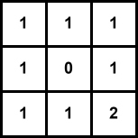

+++
date = '2026-05-10T17:08:43+08:00'
title = "动态规划：01背包应用"
tags = ["数据算法"]
categories = ["数据算法"]
+++

## 怎么判断是不是可以使用动态规划

如果某一个问题有很多重叠子问题，那就很适合使用动态规划。
那什么是是重叠子问题，就是每一个状态是可以由上一个状态推导出来


## 动态规划的解题步骤

1. 确定dp数组
2. 确定递推公式
3. dp数组初始化
4. 确定遍历顺序
5. 举例推导dp数组


## 1. 斐波那契数

### 题目描述：

斐波那契数，通常用 F(n) 表示，形成的序列称为 斐波那契数列 。该数列由 0 和 1 开始，后面的每一项数字都是前面两项数字的和。也就是： F(0) = 0，F(1) = 1 F(n) = F(n - 1) + F(n - 2)，其中 n > 1 给你n ，请计算 F(n) 

### 思路

0. **为什么可以用动态规划**
因为每一个数字是由前一个和前两个数字的推导出来的结果

1. **确定dp数组**
一维数组dp[i] :第i个数的斐波那契数是dp[i]

2. **确定递推公式**
dp[i] = dp[i-1]+dp[i-2]

3. **dp数组初始化**
- dp[i] 依赖于更小的索引 i-1 和 i-2。
- 方向是：从左向右计算。
- 初始化dp[0]和dp[1]

4. **确定遍历顺序**
方向是从左到右

5. **举例推导**
假设N是10，dp数组应该是如下的数列：
0 1 1 2 3 5 8 13 21 34 55

### 代码解法
```go
func fib(n int)int{
    if n < 2 {
        return n
    }

    dp := make([]int,n)
    dp[0] = 0
    dp[1] = 1
    for i := 2; i<n; i++{
        dp[i] = dp[i-1] + dp[i-2]
    }

    return dp[n]
}
```

- 时间复杂度：O(n)
- 空间复杂度：O(n)

## 2. 爬楼梯

### 题目描述：
假设你正在爬楼梯。需要 n 阶你才能到达楼顶。

每次你可以爬 1 或 2 个台阶。你有多少种不同的方法可以爬到楼顶呢？

注意：给定 n 是一个正整数。

### 思路

0. **为什么可以用动态规划**
想象如果站在第i个台阶上，那只有两个方法能登上去，那就是从i-1个台阶上爬一个台阶上去，或者从i-2的台阶上爬两个台阶上去。

1.  **确定dp数组**
一维数组dp[i]：登上第i个台阶有几种方法

2. **确定递推公式**

dp[i] = dp[i-1] + dp[i-2]
> 注意这里是方法数，所以不需要加1

3. **dp数组初始化**
- 从左到右
- 依赖前两个的结果
那就是dp[1]和dp[2]需要提前预定

> 为什么不是dp[0]? 因为n是一个正整数


4. **确定遍历顺序**
从左到右

5. **举例推导**

举例n=5

1 2 3 5 8

```go
func climStairs(n int){
    if n <= 2 {
        return n
    }

    dp := make([]int,n+1)
    dp[1],dp[2] = 1, 2
    
    for i := 3;i<=n;i++{
        dp[i] = dp[i-1]+dp[i-2]
    }

    return dp[n]
}
```

## 3. 使用最小花费爬楼梯

### 题目描述

给你一个整数数组 cost ，其中 cost[i] 是从楼梯第 i 个台阶向上爬需要支付的费用。一旦你支付此费用，即可选择向上爬一个或者两个台阶。

你可以选择从下标为 0 或下标为 1 的台阶开始爬楼梯。

请你计算并返回达到楼梯顶部的最低花费。


### 思路

0. **为什么可以用动态规划**
和上一个题目[爬楼梯](#2-爬楼梯)是一样的思路，只是多了一项花费
想象如果站在第i个台阶上，那只有两个方法能登上去，那就是从i-1个台阶上爬一个台阶上去，或者从i-2的台阶上爬两个台阶上去。

1.  **确定dp数组**
一维数组dp[i]:第i个台阶需要的最低花费

2. **确定递推公式**

dp[i] = min(dp[i-1]+cost[i-1],dp[i-2]+cost[i-2])

3. **dp数组初始化**

- 每一个i依赖前两个
- 初始化dp[0] dp[1]
- 题目中中`你可以选择从下标为 0 或下标为 1 的台阶开始爬楼梯`  -> dp[0] = 0 dp[1] = 0
4. **确定遍历顺序**
从左到右

5. **举例推导**
举例：
cost ： [1, 100, 1, 1, 1, 100, 1, 1, 100, 1]楼顶
下标 ：  0   1   2   3  4  5    6  7   8   9  10 
dp   ：  0   0   1  2  2   3   3  4   4   5  6

```go
func minCostClimbingStairs(cost []int)int{
    n := len(cost)
    dp := make([]int,n+1)
    dp[0],dp[1] = 0,0
    for i := 2;i<=n;i++{
        dp[i] = min(dp[i-1]+cost[i-1],dp[i-2]+cost[i-2])
    }
    return dp[n]
}
```


## 4. 不同路径
### 题目描述
一个机器人位于一个 m x n 网格的左上角 （起始点在下图中标记为 “Start” ）。

机器人每次只能向下或者向右移动一步。机器人试图达到网格的右下角（在下图中标记为 “Finish” ）。

问总共有多少条不同的路径？

### 思路
0. **为什么可以用动态规划**
本质和[爬楼梯](#2-爬楼梯)相同

如果要到右下角，那必然是从上方或者左方来的，那只要知道上方和左方的方法是多少就可以了。


1.  **确定dp数组**

dp[i][j]:到达位置(i,j)的方法有几种

2. **确定递推公式**

dp[i][j] = dp[i-1][j] + dp[i][j-1]

3. **dp数组初始化**


可以看出是从上往下走、从左往右走，那必须最上面的一行、最左边的一列要初始化

dp[0][j] = 1 从(0,0)到(0,j)的路径只有一条

dp[i][0] = 1 从(0,0)到(i,0)的路径只有一条


4. **确定遍历顺序**
从上往下走、从左往右走


5. **举例推导**


```go
func uniquePaths(m int, n int)int{
    dp := make([][]int,m)
    for i := range dp {
        dp[i] = make([]int,n)
    }
    for i := 0;i < m; i++{
        dp[i][0] = 1
    }
    for j := 0;j < n; j++{
        dp[0][j] = 1
    }

    for i := 1;i < m;i++{
        for j := 1;j<n;j++{
            dp[i][j] = dp[i-1][j] + dp[i][j-1]
        }
    }

    return dp[m-1][n-1]
}
```

- 时间复杂度：O(m × n)
- 空间复杂度：O(m × n)


## 5. 不同路径2

### 题目描述
一个机器人位于一个 m x n 网格的左上角 （起始点在下图中标记为“Start” ）。

机器人每次只能向下或者向右移动一步。机器人试图达到网格的右下角（在下图中标记为“Finish”）。

现在考虑网格中有**障碍物**。那么从左上角到右下角将会有多少条不同的路径？

### 思路
0. **为什么可以用动态规划**
本质和[不同路径](#4-不同路径)相同

如果要到右下角，那必然是从上方或者左方来的，那只要知道上方和左方的方法是多少就可以了。

同时多了一个分支就是遇到障碍物了，那这个位置的dp[i][j]根据定义就是0，因为到不了这个位置。

1.  **确定dp数组**

dp[i][j]:到达位置(i,j)的方法有几种

2. **确定递推公式**

dp[i][j] = dp[i-1][j] + dp[i][j-1]

但这里需要注意一点，因为有了障碍，(i, j)如果就是障碍的话应该就保持初始状态（初始状态为0）。

3. **dp数组初始化**


可以看出是从上往下走、从左往右走，那必须最上面的一行、最左边的一列要初始化

dp[0][j] = 1 从(0,0)到(0,j)的路径只有一条

dp[i][0] = 1 从(0,0)到(i,0)的路径只有一条

但是需要考虑如果障碍物放在了第一行或第一列的情况

```go
for i := 0;i < m;i++{
    if obstacleGrid[i][0] == 0{
        dp[i][0] = 1
    }
}

for j := 0;j < n;j++{
    if obstacleGrid[0][j] == 0{
        dp[0][j] = 1
    }
}
```


4. **确定遍历顺序**
从上往下走、从左往右走


5. **举例推导**




```go
func uniquePathsWithObstacles(obstacleGrid [][]int) int {
	m := len(obstacleGrid)
	n := len(obstacleGrid[0])
	if obstacleGrid[m-1][n-1] == 1 || obstacleGrid[0][0] == 1 {
		return 0
	}

	dp := make([][]int, m)
	for i := range dp {
		dp[i] = make([]int, n)
	}

	for i := 0; i < m; i++ {
		if obstacleGrid[i][0] == 1 {
			break
		}
		dp[i][0] = 1
	}

	for j := 0; j < n; j++ {
		if obstacleGrid[0][j] == 1 {
			break
		}
		dp[0][j] = 1
	}

	for i := 1; i < m; i++ {
		for j := 1; j < n; j++ {
			if obstacleGrid[i][j] == 1 {
				continue
			}
			dp[i][j] = dp[i-1][j] + dp[i][j-1]
		}
	}
	return dp[m-1][n-1]
}
```

## 6. 整数拆分

### 题目描述

343. 给定一个正整数 n，将其拆分为至少两个正整数的和，并使这些整数的乘积最大化。 返回你可以获得的最大乘积

### 思路

0. **为什么可以用动态规划**
给一个整数n，假设是拆分成两个数的和，假设是i和j，那就是i*j的积最大，只需要便利i即可，j = n-i 即max(i*j)

但是题目说是至少两个，那就需要对i进行二次拆分，那再拆i之前，n-i肯定是不变的，问题就变成了求i的最大乘积。

就变成了子问题，继续上面的步骤。


1.  **确定dp数组**

根据上面的讲解，那假设dp[i]:整数i拆分后的最大乘积

2. **确定递推公式**

dp[i] = max(j*(i-j),j*dp[i-j])

- 两数乘积 j * (i-j)
- 多数乘积 j * dp[i-j]

3. **dp数组初始化**
根据dp的定义，理论是不需要初始化。
但是如果是拆分的话，那必须是从2开始才可以进行拆分
dp[0] 和 dp[1] 无意义（无法拆成至少两个正整数），但为了计算方便可以设为 0


4. **确定遍历顺序**
dp[i]是依靠dp[i-j]的，所以i是从小到大的顺序
从小到大


5. **举例推导**
模拟n=5

| i | j | j*(i-j) | j * dp[i-j] | Current_max | dp[i] |
| :-: | :-: | :-: | :-: | :-: | :-: |
| 2 | - | - | - | - | 1 | 
| 3 | 1 | 1*2=2 | 1*dp[2]=1 | 2 | 2 | 
| 3 | 2 | 2*1=2 | 2*dp[1]=0 | 2 | 2 |
| 4 | 1 | 1*3=3 | 1*dp[3]=2 | 3 | 3 |
| 4 | 2 | 2*2=4 | 2*dp[2]=2 | 4 | 4 |
| 4 | 3 | 3*1=3 | 3*dp[1]=0 | 3 | 4 |
| 5 | 1 | 1*4=4 | 1*dp[4]=4 | 4 | 4 |
| 5 | 2 | 2*3=6 | 2*dp[3]=6 | 6 | 6 |  
| 5 | 3 | 3*2=6 | 3*dp[2]=3 | 6 | 6 |  
| 5 | 4 | 4*1=4 | 4*dp[1]=0 | 4 | 6 |       

```go
func integerBreak(n int) int {
	if n < 2 {
		return 0
	}
	dp := make([]int, n+1)
	dp[2] = 1
	for i := 3; i <= n; i++ {
		for j := 1; j < i-1; j++ {
			// 对于一个固定的i，遍历所以可能的j（1到i-1）
			dp[i] = max(dp[i], max(j*(i-j), j*dp[i-j]))
		}
	}
	return dp[n]
}
```

