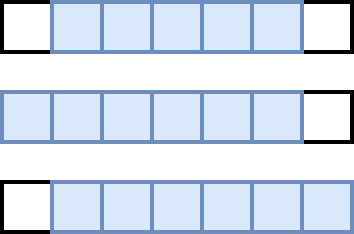
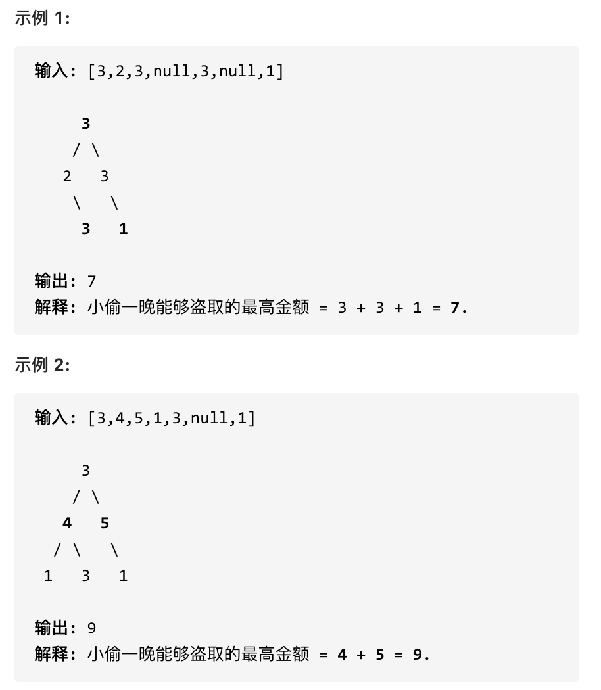

+++
date = '2026-05-15T11:50:19+08:00'
title = "动态规划：打家劫舍"
tags = ["数据算法"]
categories = ["数据算法"]
+++

## 1. 打家劫舍

### 题目描述

198. 你是一个专业的小偷，计划偷窃沿街的房屋。每间房内都藏有一定的现金，影响你偷窃的唯一制约因素就是相邻的房屋装有相互连通的防盗系统，如果两间相邻的房屋在同一晚上被小偷闯入，系统会自动报警。

给定一个代表每个房屋存放金额的非负整数数组，计算你 不触动警报装置的情况下 ，一夜之内能够偷窃到的最高金额。

### 思路

每进入一间房屋，会有两个选择， 那就是偷或者不偷，而这个决定取决于前一个房间是否被偷了

1. **确定dp数组**

dp[i]：考虑下标i（包括i）以内的房屋，最多可以偷窃的金额为dp[i]。

2. **确定递推公式**

决定dp[i]的因素就是第i房间偷还是不偷。

- 偷：那就是上一个房间没偷，那dp[i] = dp[i-2] + value[i]
- 不偷：那就是上一个房间偷了，那dp[i] = dp[i-1]

那最终的最大金额就是max(dp[i-2] + value[i],dp[i-1])

3. **dp数组初始化**

可以看出i是依赖i-1 i-2的，那肯定第一个和第二个是需要初始化的。

dp[0] = nums[0]
dp[1] = max(nums[0],nums[1])

4. **确定遍历顺序**

从前到后

### 代码

```go
func rob(nums []int) int {
	n := len(nums)
	if n < 2 {
		return nums[0]
	}
	dp := make([]int, n)
	dp[0] = nums[0]
	dp[1] = max(nums[0], nums[1])

	for i := 2; i < n; i++ {
		dp[i] = max(dp[i-1], dp[i-2]+nums[i])
	}

	return dp[n-1]
}
```


## 2. 打家劫舍2

### 题目描述

213. 你是一个专业的小偷，计划偷窃沿街的房屋，每间房内都藏有一定的现金。这个地方所有的房屋都 围成一圈 ，这意味着第一个房屋和最后一个房屋是紧挨着的。同时，相邻的房屋装有相互连通的防盗系统，如果两间相邻的房屋在同一晚上被小偷闯入，系统会自动报警 。

给定一个代表每个房屋存放金额的非负整数数组，计算你 在不触动警报装置的情况下 ，能够偷窃到的最高金额。

### 思路

这个题目与[打家劫舍](#1-打家劫舍)的不同在于首尾是相连的，那其实首尾两个房间的判断需要单独拎出来。

其实就是三种情况

- 不考虑首尾
- 考虑首、不考虑尾
- 不考虑首、考虑尾



注意我这里用的是"考虑"，例如情况三，虽然是考虑包含尾元素，但不一定要选尾部元素！ 

而情况二 和 情况三 都包含了情况一了，所以只考虑情况二和情况三就可以了。

那其实这样环就断开了，就与[打家劫舍](#1-打家劫舍)一模一样了。

```go
func rob(nums []int) int {
	n := len(nums)
	if n == 0 {
		return 0
	}
	if n == 1 {
		return nums[0]
	}
	nums_1 := nums[0 : n-1]
	nums_2 := nums[1:n]

	return max(robRange(nums_1), robRange(nums_2))

}

func robRange(nums []int) int {
	n := len(nums)
	if n == 0 {
		return 0
	}
	if n == 1 {
		return nums[0]
	}

	dp := make([]int, n)
	dp[0] = nums[0]
	dp[1] = max(nums[0], nums[1])
	for i := 2; i < n; i++ {
		dp[i] = max(dp[i-1], dp[i-2]+nums[i])
	}

	return dp[n-1]
}
```

## 3. 打家劫舍3

### 题目描述

337. 在上次打劫完一条街道之后和一圈房屋后，小偷又发现了一个新的可行窃的地区。这个地区只有一个入口，我们称之为“根”。 除了“根”之外，每栋房子有且只有一个“父“房子与之相连。一番侦察之后，聪明的小偷意识到“这个地方的所有房屋的排列类似于一棵二叉树”。 如果两个直接相连的房子在同一天晚上被打劫，房屋将自动报警。

计算在不触动警报的情况下，小偷一晚能够盗取的最高金额。




### 思路

这个题目与[打家劫舍](#1-打家劫舍)的思想是相同的，那就是父节点偷和不偷取决于子节点偷没偷。

- 如果要偷父节点 -> 那左右节点都能不偷  -> 要左右节点不偷的最大金额

- 如果不偷父节点 -> 那左右节点就是自由选择 -> 要左右节点偷和不偷的最大金额

所以dp数组就出来了。

1. **确定dp数组**

dp[i]=[a,b]:下标为0记录不偷该节点所得到的的最大金钱，下标为1记录偷该节点所得到的的最大金钱

2.**确定递推公式**

- 不偷父节点
dp[0] = max(left[0],left[1]) + max(right[0],right[1]) 

- 偷父节点
dp[1] = left[0] + right[0] + value

3. **dp数组初始化**

其实就是树的终止条件

`if cur == nil{return []int{0,0}}`

4. **确定遍历顺序**

先知道左右节点的信息，再根据这些信息父节点做判断，所以是后序遍历

### 代码

```go
/**
 * Definition for a binary tree node.
 * type TreeNode struct {
 *     Val int
 *     Left *TreeNode
 *     Right *TreeNode
 * }
 */
package main

func rob(root *TreeNode) int {
	if root == nil {
		return 0
	}

	res := robTree(root)
	return max(res[0], res[1])
}

func robTree(cur *TreeNode) []int {
	if cur == nil {
		return []int{0, 0}
	}

	left := robTree(cur.Left)
	right := robTree(cur.Right)

	// 偷根节点
	robroot := cur.Val + left[0] + right[0]

	// 不偷根节点
	notrobroot := max(left[0], left[1]) + max(right[0], right[1])

	return []int{notrobroot, robroot}
}

```

